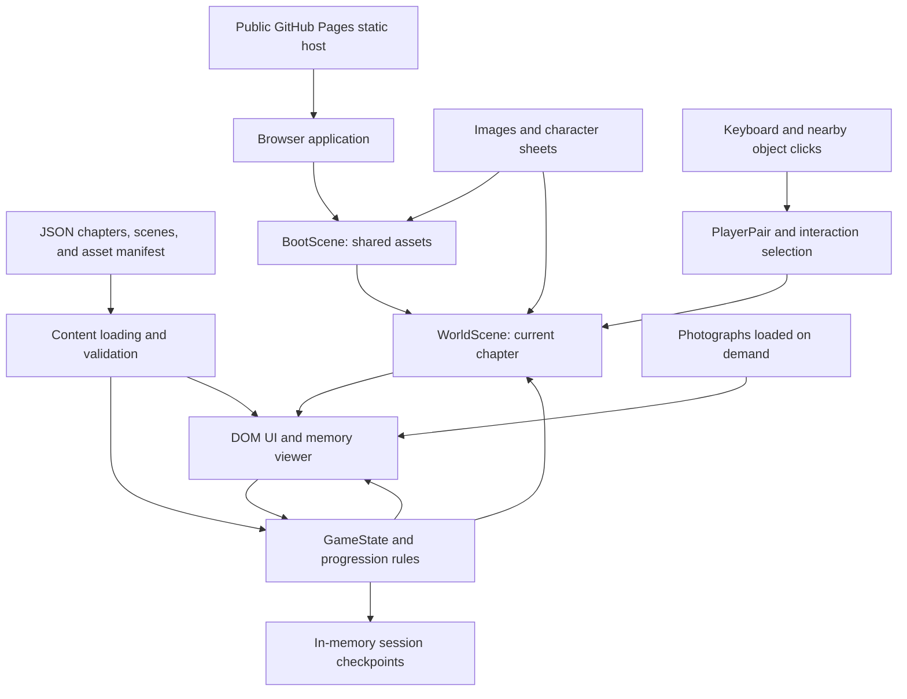

# Anniversary Game: Scope and Architecture

Planning date: October 13, 2026. Revised October 14, 2026 after owner direction. Status: Milestones 1–3 implemented; October 14 revisions integrated; Milestone 4 release work remains. Section 8 and the latest implementation record supersede older planning assumptions.

This is the persistent planning reference for future development sessions. Read it before scaffolding or changing the game. Recommendations below are defaults, not claims that the owner has approved them. Any change to scope, controls, content format, or deployment privacy should be recorded here with its reason.

The initial planning inspection found an empty project directory, no Git repository, and no applicable AGENTS.md instructions. The original planning phase created only this document. The owner subsequently authorized workspace creation and Milestone 1 implementation; the workspace now contains the prototype, dependencies, tests, and a local main Git branch. Nothing has been pushed or deployed.

## Revision 1 — confirmed direction

The owner has approved a public GitHub Pages delivery and does **not** want a save system or an email-code access gate. The story has **Korea**, **Austin** (including the Norway scrapbook), and a **Madeira proposal** finale. The introduction starts directly on its map and opens customization at the letter. The authoritative movement controls are **WASD**; **Q** switches the leading character; **E** interacts with a nearby highlighted object; a clear on-screen button and direct clickable objects provide backup. A/D also turn photographs and scrapbook pages while a viewer is open. Arrow keys are not part of the movement scheme.

Interaction is intentionally leader-specific. Every required interaction declares whether `person-a` or `person-b` must lead, with a gentle “It’s [name]’s turn to lead — press Q” prompt and a clickable switch button. Both characters remain together, but they take turns starting particular moments. This adds a small shared-adventure rhythm without demanding difficult coordination or allowing either person to become stuck.

“Checkpoint” means an in-session scene completion marker: after a scene is completed, the next scene unlocks and the pair moves to its safe spawn. Reloading the public link begins from the introduction. There is no local or server-side save, account, or persistence requirement.

Personal photographs and repository contents will be publicly downloadable from a public GitHub Pages site. The public link should be treated as intentionally shareable with anyone who receives it, not as secret. A URL prefix such as `https://pages.github` is not an access-control feature and is not the GitHub Pages URL format. See section 10 for the correct link form and photo-publishing workflow.

## 1. Executive summary and game vision

Build a short browser-based storybook that the couple can explore together while one person operates the controls. Two visible characters walk through small illustrated places, open photographs and memories, share playful questions, and arrive at a proposal end scene. Emotional specificity comes from the owner's writing and photographs, rather than complex mechanics.

**Current complete scope:** a customizable introduction map, four Korea worlds, three worlds labelled Austin, and Madeira: nine worlds with 35 original photographs and 34 themed versions. Each world establishes an in-session checkpoint. Separate photo interactions, a pedal railway, a floor puzzle, a five-page scrapbook and driving provide the activity beats. The proposal completes the ordered journey; the island remains open, and completed worlds can be revisited. The original 20–30 minute estimate remains a walkthrough target to verify with the owner.

Use **Phaser 4 + TypeScript + Vite**, with ordinary HTML/CSS for menus, character-anchored speech, photographs, and questions. Keep chapter definitions and story content in JSON. Use one reusable world scene, world bounds with explicitly specified gameplay barriers only, a Q-switchable leader, and a companion who follows. The game keeps the current checkpoint only in memory for the current browser session. Deploy the static build to a public GitHub Pages URL.

Success means the recipient can open the link, understand how to move and interact within a minute, finish without assistance or frustration, recognize the couple in the characters and content, and leave with a meaningful final message. A small, polished experience is the release goal.

## 2. Product requirements and non-goals

### Confirmed requirements from the owner

- An anniversary gift for a fiancée, celebrating three years together.
- Cozy, romantic, story-driven 2D environments with two visible character sprites.
- One physical operator at a time; easy controls for someone with little gaming experience.
- Exploration and interactions revealing the supplied Korea, Austin/Norway, and Madeira proposal moments through photographs, dialogue, gentle puzzles, and reflections.
- An introduction, the two owner-defined destination chapters, and a proposal finale with a coherent guided order.
- Illustrated art mixed with real photographs, achievable without professional art skills or a large asset budget.
- Windows development and MacBook play, preferably a website opened through a link without installing software.
- A lightweight, inexpensive design, reusable content systems, no backend, no save requirement, and a public GitHub Pages link.
- The original phase was planning in GAME_DESIGN.md only. The owner subsequently authorized implementation of Milestone 1.

### Proposed release requirements

| Area | Requirement and release measure |
| --- | --- |
| Story | Introduction, four Korea scenes, four Austin/Norway scenes, and a Madeira proposal finale. Each completed scene is an in-session checkpoint. |
| Controls | WASD to move; E to interact; Q to switch leader; click highlighted objects/buttons as backup; visible on-screen help; no platforming or precise timing. |
| Characters | Both remain present. Some interactions require a named character to lead, so purposeful Q switching is required. |
| Guidance | Named next stop, a visible landmark, and a Help action that returns the pair to a safe point beside that stop. |
| Recovery | Safe scene transitions in the current session; reloading intentionally restarts from the introduction. |
| Photos | Portrait and landscape photographs remain uncropped in the reading view, with captions and alt text. |
| Accessibility | Keyboard-operable text UI, readable contrast and sizing, no timed dialogue, reduced motion, and an easier movement option. |
| Compatibility | Actual MacBook Safari testing is required before release; also test Windows Chrome/Edge and Firefox. |
| Delivery | Public HTTPS GitHub Pages link; no recipient development tools. All repository assets are treated as shareable. |

### Non-goals

No combat, lives, failure states, scores, currency, crafting, inventory puzzles beyond the one small escape-room puzzle, real-time multiplayer, accounts, networking, cloud saves, or generated dialogue during play. No large seamless world, procedurally generated maps, complex NPC behavior, custom physics, or bespoke minigame framework. No complete screen-reader navigation of the spatial world promised for MVP; the alternative reading route described below provides access to the story.

## 3. Core gameplay and control recommendations

### Movement and character control evaluation

| Approach | Benefit | Cost or risk | Decision |
| --- | --- | --- | --- |
| Free top-down movement | Familiar directional input, visible exploration, few systems. | Needs collision and clear destinations. | **Use for MVP**, with generous paths and a fixed camera in most areas. |
| Side-view movement | Fewer directions and simpler sprites. | Less spatial freedom; can imply jumping/platforming. | Viable fallback only if an early prototype feels better. |
| Click-to-move | Comfortable mouse-only input. | Obstacle routing, destination cues, and stuck recovery add work. | Exclude; it would duplicate WASD movement and need pathfinding. |
| Clickable world objects | A reliable mouse/trackpad backup for interaction. | Needs clear hover state and range feedback. | **Use for MVP.** Clicking a nearby object opens it; a distant click names the object and invites the player closer. |
| Two characters controlled simultaneously | Both respond directly. | Unfamiliar coordination; contradicts low-friction solo operation. | Exclude. |
| Fixed leader with follower | Minimal instruction burden. | Less choice about who represents the player. | Starting behavior; switching is an optional extra. |
| Switchable leader with follower | Lets either person lead with the same controls. | A little extra input and follower state management. | **Required MVP mechanic.** Scenes identify moments where the correct character must lead. |

Controls while the world has focus:

| Action | Input | Visible alternative |
| --- | --- | --- |
| Move | WASD | Small control reminder; easier movement setting. |
| Read nearest memory / use an exit | E | Click the highlighted nearby object or the Read button. |
| Switch leader | Q | Button labeled with the character who will lead next. |
| Pause / close the current panel | Escape | Pause or Close button. |
| Navigate dialogue and questions | Standard Tab, Enter/Space on focused buttons | Mouse or trackpad buttons. |

Do not intercept Tab for switching characters: it must retain normal UI focus navigation. E and Q have no meaning inside a text modal. WASD moves only when the world is active, and should not scroll the page in that state. Opening a modal or losing browser focus clears held movement keys. Restoring focus never moves a character until fresh input.

### Recommended movement and follower behavior

- Begin with a 960 × 540 logical viewport. Most areas fit within one screen; allow up to roughly 1.5 screens only where clearly useful. Scale to the available window while DOM text retains normal CSS sizing.
- Start at about 130 world pixels per second, with no run button and normalized diagonal velocity. These values are tuning defaults, not fixed product requirements.
- Use Arcade Physics with zero gravity and a small leader body at the feet for world bounds. Add collision rectangles only for gameplay barriers explicitly specified in this design; trees, benches, flowers, shops, and restaurants are decorative and do not block walking. The current introduction and first-date maps have empty obstacle lists. World bounds prevent walking off the page. Sort characters and tall props by their foot position for believable overlap.
- The follower tracks a short breadcrumb trail left by the leader, roughly 36–48 pixels behind. Record points by distance moved, not every frame; remove them as consumed and bound the queue. Follow travelled segments rather than steering directly through corners.
- The follower is non-blocking and has no gameplay collision body. Broad paths and at least about 64 pixels of walkable clearance keep both sprites visually clear. Do not require the follower to reach an object, doorway, or switch.
- If separation exceeds about 160 pixels or movement appears stuck for about two seconds, gently fade the companion to the last safe trail point near the leader. A chapter transition places both at authored safe spawns and clears the trail.
- Switching keeps both current positions, makes the former follower the leader, zeros velocity, and resets the trail. Retain a last safe position for either character; validate placement before enabling movement. When a leader-specific object is nearby, show the required leader’s name and the Q/button affordance. Camera movement should be absent or gentle, especially with reduced motion.
- If this behavior costs more than one development session to make reliable, simplify the companion to a tested offset with fade-and-reposition recovery. Do not add a navigation mesh or pathfinding library to rescue the follower.

### Interaction and progression contract

The gameplay loop is **explore → approach a marked object → switch to the appropriate leader when invited → interact/read/solve a short beat → receive the scene checkpoint → transition to the next named moment**.

Select only one nearby target, normally within 64 world pixels of the leader, using nearest distance and stable ID order as a tie-breaker. Its name and prompt must match the object that E activates. Place objects' approach points on accessible ground; do not offer interactions through a solid wall. Clicks use the same range rules and selection system. Clicking a distant object says “Walk closer to [object label]” rather than teleporting or silently failing. A nearby leader-specific target says “Let [name] lead — Q” and exposes the same switch through a button; the target does not open until that person leads.

A memory consists of ordered steps: photograph, caption/text, speaker-labelled dialogue, optional trivia, or reflection. The same viewer handles all memories. Opening it pauses leader and follower movement. Reaching its last step and choosing Done marks it completed once. Closing early leaves it incomplete; reopening starts it again. Completed memories remain readable and their last question choice can be changed without undoing progress.

Trivia offers two or three choices, a friendly reveal, and Skip. Incorrect answers and Skip never block story completion; there is no score. Reflection asks a question to discuss aloud and offers Continue or Skip. No free-text collection is needed for MVP.

Each scene has explicit completion conditions. Completing it stores the next scene index in the in-memory session state, shows a small checkpoint marker, and presents a visible Continue invitation; the player is never teleported without confirmation. The finale unlocks after all eight named nonfinal scenes. Reloading restarts the gift from the introduction by design, so "Return to chapter" is not an MVP feature.

### Guidance for a new player

Load directly into the introduction map with both people in the upper right; there is no initial welcome/start screen. Place “Use WASD to walk” near them and a letter in the lower right. Nearby guidance says “Press E or click the letter”; interacting opens the menu to name both people and customize the gift greeting. Submission creates the introduction checkpoint and offers the Korea transition. Later show “Press Q to let [name] lead” at leader-specific objects. All instructions remain available under Help.

Keep only one line of title and an optional compact controls strip outside the map. Place guidance, switching, interaction, and Pause/Help controls within the game, with no separate sidebar. Interaction badges must be obvious and clickable. Display all three bouquets inside the flower window and give each its own E/click target. Convey shop/restaurant purpose through their appearance rather than invented business names. Speaker IDs belong to story content; speech bubbles follow the corresponding person's position, with the tail pointing to that person. When a line precedes a photograph, show it in the world first and let E/the memory button open the viewer afterward.

Each chapter has a short, scenic route through its named scenes, with just enough open space to look around. A persistent sentence gives the next scene's label, rather than displaying a quest log. Completed scenes receive a checkmark plus text so color is never the only signal. Keep guidance enabled by default; turning it off preserves exploration.

Help offers “Bring us to the next moment,” which fades the pair to that object's authored safe approach point without completing it. A “Read our story” route in the pause menu lists scenes reached in the current session and allows their dialogue/photos to be read through the same DOM viewer. This ensures keyboard movement difficulty cannot prevent finishing the gift. An always-visible Pause/Help button makes this route discoverable.

Open-world feeling comes from freely choosing paths, revisiting stops, scenery, and optional details inside each small area. Story order comes from chapter boundaries and essential stops. A giant map is unnecessary to achieve that feeling.

### Gameplay directions to prototype before committing

| Direction | What the player does | Fit for the supplied moments | Scope | Recommendation |
| --- | --- | --- | --- | --- |
| Guided memory-date adventure | Walk a compact scenic route, hand leadership back and forth, do one meaningful interaction, then receive a checkpoint. | Flowers, railway, cafe, Francine, and Madeira all feel natural; the escape room becomes the one deeper puzzle. | Low–medium. | **Prototype this first.** It gives the game a real rhythm without making every memory a minigame. |
| Interactive travel dioramas | Each moment is a self-contained illustrated diorama entered from a route map; click or WASD within it, then return to the map. | Lets every destination look distinct and makes photos central. | Low–medium. | Strong alternative if a traditional walkable chapter feels too game-like or too empty. |
| One connected scrapbook puzzle | Collect a small postcard/stamp/clue from each scene; together they unlock the proposal letter. | The escape room provides a natural clue motif. | Medium. | Use only if the owner likes a light meta-puzzle. Keep it symbolic and never make the proposal contingent on hard puzzle solving. |
| Short role-based minigame anthology | Every scene has a distinct 30–60 second activity: arrange flowers, start railway car, solve escape room, assemble ice cream, trace Norway route, plan Francine trip, order cafe item. | Energetic and varied. | High; polish risk rises sharply. | Version 2 direction, or select only two of these tasks for MVP. |
| Fully open exploration map | Roam a larger Korea/Austin/Norway world and discover memories in any order. | Gives an expansive travel feeling. | High; risks navigation confusion and unused art. | Do not use for the first release. |

The first prototype should compare the guided adventure against the diorama alternative using the flowers/katsu/ice-cream scene. If walking to a flower stand, passing leadership, opening the meal/photo beat, and reaching a clear checkpoint feels charming, retain the guided structure. If it feels like walking between menus, switch to dioramas early; the same JSON scenes, photos, dialogue, leader rule, and final proposal still apply.

## 4. Art direction and asset strategy

These are planning judgments about effort, not promises about asset-production speed.

| Style | Emotional fit and photos | Character consistency / animation | Environment authoring and solo effort | Relative time |
| --- | --- | --- | --- | --- |
| Pixel art | Charming and intimate; photo panels need a deliberate scrapbook border to bridge styles. | Small sheets are manageable, but good silhouettes and consistent pixel scale take practice. | Existing matching tiles can be fast; mixing packs is conspicuous. | Low–medium with one matching pack. |
| Detailed hand-drawn illustration | Strong storybook atmosphere; photographs fit naturally. | Matching multiple views and walking frames is the hardest part. | Beautiful backgrounds take repeated revision; perspective must match navigation. | High. |
| Traditional top-down RPG tiles | Clear exploration and readable paths; photographs suit menu panels. | Many inexpensive sprite packs, but personal likeness and warm tone need adaptation. | Tile workflow is efficient once established, but adds a map editor and tile conventions. | Medium. |
| Simple illustrated paper-cut shapes | Warm, personal, and visually coherent with framed real photographs. | Repeatable proportions, clothing, and flat shading; tiny walk cycles suffice. | Reusable plants, benches, frames, rugs, and paths assembled over simple backgrounds. | Low–medium; **recommended**. |

Use a **warm, bubbly semi-illustrated storybook**: rounded forms, soft gradients, visible but simplified facial features, cream/peach/terracotta accents, and scene-specific colors (Korea's autumn gold, Museum of Ice Cream pink, Norway's blue-violet night, Madeira sunset coral). It is more expressive and recognizable than flat paper-cut art without attempting heavy photorealism. A limited palette, recurring brush/outline treatment, and a small “style bible” matter more than detail. Use an overhead ground plane with lightly angled character/prop fronts; avoid isometric perspective and its extra collision work.

Character identity should come from owner-approved hair, skin tone, clothing, face shape, and two or three recognizable wardrobe/accessory cues. Create one approved reference sheet for each character before animation. Use four directions, each with one idle and two walking frames: 12 frames per character, 24 total. A practical source sheet is three columns (idle, step A, step B) by four rows (down, left, right, up), with **96 × 96 pixel** source frames and a common foot anchor; render them at about 64–72 logical pixels. Prototype with one static frame per character first. Two-frame walking at about 5–6 frames per second is sufficient; elaborate animation is deferred.

Asset inventory for the initial release:

- Two character sheets and small DOM portraits derived from their idle frames.
- One reusable environment set of roughly 10–15 props, a path treatment, two chapter hub backdrops, scene overlays/landmarks, and a Madeira finale backdrop.
- One neutral frame/envelope icon shared across memory locations; a checkmark and a static interaction marker.
- One to two optimized real photographs per named scene, with a target of 10–15 total public web copies.
- System fonts initially; at most one locally bundled licensed display font later. Audio is optional Version 2.

Use a single licensed asset pack or simple owner-created shapes as the base. AI image generation can create **scene-concept references and selected backdrop elements**, but it is poor at consistently animating recognizable people across four directions. Preserve real photographs as the source of exact likeness in the scrapbook viewer. If using Gemini or another generator, first make one style reference with the palette, viewpoint, line weight, character-height, and “no text/no watermark” constraints; use it consistently for background concepts, then manually clean/resize the chosen outputs. Do not feed every private photograph into an external generator by default, and do not make transformed AI portraits the sole record of a memory. Photograph originals and character likeness references should not be uploaded to an external art service without the owner's agreement. Track asset provenance and license requirements in a small manifest note when assets actually exist.

World objects suggest a physical memory: a framed picture, picnic note, travel postcard, or envelope. The photo itself opens in a roomy DOM scrapbook panel with object-fit contain, an owner-written caption, and speaker labels. Do not shrink the real photograph into a tiny game texture or distort it to fit the scene. A simple “Memories we've read” list reopens completed entries; a decorative album grid is Version 2.

Export character/prop transparency as PNG and photographs as JPEG or WebP. For each public photograph, preserve its aspect ratio and resize to a **1600 pixel long edge**: typically 1600 × 1200 landscape, 1200 × 1600 portrait, or 1400 × 1400 square. Use WebP quality about 80–85 after inspecting faces; keep the publishable copy generally below 500 KB, but prioritize clarity when a photo needs more. Scene backgrounds should be 1920 × 1080 WebP (a 2× source for the 960 × 540 logical viewport) and normally under 700 KB; sprite frames use the 96 × 96 sheet described above; props use 256–512 pixel PNG/WebP textures. Use small frame thumbnails only if needed later. Normalize photo orientation, remove EXIF/GPS and other metadata, use neutral filenames, and preserve originals privately outside the publishable tree. Export SVG source art to static textures if that simplifies rendering; avoid shaders or filters for the paper effect.

## 5. Technology evaluation and final recommendations

### Engine choices

| Option | Advantages for this project | Trade-off | Recommendation |
| --- | --- | --- | --- |
| Phaser | Browser-focused game framework with scenes, input, loaders, cameras, sprites, and simple physics; TypeScript definitions. | Larger than a custom canvas page; tutorials may target different major versions. | **Choose Phaser 4**, with a deliberately small subset of features. |
| Plain HTML/CSS + Canvas 2D | Few dependencies, full control, suitable for a hotspot storybook. | Must build collision, scene lifecycle, sprite animation, and loading behavior ourselves. | Best fallback if walking is dropped; less efficient for the confirmed explorable world. |
| PixiJS | Capable 2D rendering and input with a flexible scene graph. | Rendering focus means more game systems must be assembled. | Useful, but Phaser reduces first-project system work. |
| Godot web export | Strong visual editor and native game authoring workflow. | Adds editor/export learning; web export uses WebAssembly/WebGL 2 and has browser-specific considerations. | Prefer only if the owner already wants an editor-based workflow. |

Phaser's browser/TypeScript fit and lightweight Arcade Physics support this choice: [framework overview](https://docs.phaser.io/phaser/getting-started/what-is-phaser), [physics documentation](https://docs.phaser.io/phaser/concepts/physics). PixiJS describes itself as a rendering engine in its [current introduction](https://pixijs.com/8.x/guides/getting-started/intro). Godot documents web requirements and Safari caveats in [Exporting for the Web](https://docs.godotengine.org/en/stable/tutorials/export/exporting_for_web.html). The relative development-effort recommendations above are our assessment of this game's needs.

### Chosen stack

- **Phaser 4**, proposed initial pin **4.2.1**, which the official [release page](https://phaser.io/download/release/v4.2.1) identifies as released July 9, 2026. Recheck releases when implementation starts, then pin a tested stable version and commit the lockfile. Never upgrade the engine silently mid-project.
- **TypeScript** for gameplay and the DOM UI, strict mode; **plain HTML/CSS** for text-heavy interfaces. No React, Next.js, component framework, router, or application state library.
- **Vite** for development and a static production build. Use a supported Node LTS version satisfying the selected Vite release's [requirements](https://vite.dev/guide/). Node is a developer/build dependency only, never required on the recipient's MacBook.
- **Arcade Physics**, zero gravity and static rectangular obstacles; no Matter physics, tilemap editor, or custom physics engine.
- **JSON content**, validated before a release build. Use small purpose-built validation functions sharing the TypeScript model; do not add a schema framework or content-management service for ten entries.
- **In-memory session state** for current-scene checkpoints and preferences; no localStorage or IndexedDB in MVP.
- **GitHub Pages** with a public GitHub repository and GitHub Actions deployment. Treat every deployed asset as public.
- At implementation time, a few **Vitest** tests for scene progression/leader rules and a small **Playwright** flow for the complete journey. They are development-only tools and are not installed in this phase.

Use Phaser.AUTO with standard sprites, images, and simple alpha fades. Phaser 4 retains a Canvas renderer but it is deprecated; treat Canvas fallback as a tested convenience, not a permanent compatibility guarantee. Avoid WebGL-only effects in MVP. If neither renderer starts, present a clear HTML error with Retry and the alternative story reader, which must work independently of Phaser. See the official [Phaser 4 rendering guidance](https://phaser.io/news/2026/04/phaser-4-renderer-faster-cleaner-and-built-for-modern-games) and [renderer selection constants](https://docs.phaser.io/api-documentation/4.0.0/constant/phaser).

Target current stable desktop Safari on the recipient's actual MacBook, Chrome/Edge on Windows, and Firefox on either desktop platform. This is a validation target, not a claim of universal support. The current macOS/browser versions are still unknown. Touch controls, mobile layouts, full-screen behavior, and offline installation are deferred.

## 6. Architecture overview and diagram

One canvas renders the world. An adjacent DOM layer renders title, HUD, pause/help, story reader, and one reusable memory dialog. An in-memory GameState object is the source of truth for progress. Content supplies data; code supplies movement, display, and completion rules.



### Major modules and boundaries

| Module | Responsibility | Boundary |
| --- | --- | --- |
| main.ts | Construct content/state/UI, mount Phaser, coordinate start/resume and errors. | No story-specific behavior. |
| content/model.ts and load.ts | Define content shapes, load listed JSON files, validate IDs/references and build indexes. | No Phaser imports; same model used by the validator. |
| state/progress.ts | Hold state; complete a memory idempotently; derive chapter unlocks, next essential stop, and ending eligibility. | Pure rules usable by world and story-reader modes. |
| state/session.ts | Hold current-session scene completion, leader, choices, and settings; reset cleanly on reload. | No serialization, photographs, or mutable Phaser objects. |
| scenes/BootScene.ts | Load shared sprite/prop textures; show progress through the DOM UI. | No personal photo preload. |
| scenes/WorldScene.ts | Build one chapter from config; place obstacles/objects; update movement, highlights, camera, and chapter changes. | Reused for all main chapters and finale. |
| world/playerPair.ts | Leader movement, follower trail, animations, safe placement, and switching. | Neither avatar owns progression. |
| world/interactions.ts | Find one reachable nearby target; handle memory/exit activation through callbacks. | No unique handlers for individual memories. |
| ui/app.ts and ui/memoryViewer.ts | Native buttons/dialogs, photographs, dialogue steps, choices, settings, help, story reader, and focus recovery. | No character movement; sends explicit actions to state/coordinator. |

Start with ordinary functions and the two Phaser scene classes. Split further only when a module becomes hard to understand. Use explicit callbacks for events such as opening a memory and applying a completed-memory action. A global event bus, entity-component system, service container, plugin registry, or custom scene framework is unnecessary.

### Scene lifecycle and main loop

1. Application shell loads and validates text content; title offers Start. The DOM story reader remains available if game rendering fails.
2. BootScene loads the small shared art set. Starting or continuing loads the requested chapter's background/props, then starts WorldScene with chapterId and a validated checkpoint.
3. Each active world update reads input, applies leader velocity, follows recorded trail points, chooses idle/walk direction, updates depth/camera, and selects one nearby interaction. Let Phaser own scheduling, rendering, and physics timing; do not introduce a second requestAnimationFrame loop.
4. Opening a modal changes a simple mode value from exploring to reading or paused, zeros movement, and stops gameplay updates/physics. UI completion dispatches an explicit in-memory scene-completion action. Closing restores focus and returns to exploring after clearing inputs.
5. Exiting a scene/chapter enters transitioning, disables input, fades if permitted, and loads the next scene art. On success restart the same WorldScene with new data and safe spawns. On load failure, retain current-session state and offer Retry or story-reader mode.
6. Shutdown removes scene listeners and clears trail/selection/timers. Shared textures stay; unload chapter-only textures after transition if necessary. The DOM UI is created once, so chapter restarts cannot duplicate buttons or listeners.

Modes are a small union: title, loading, exploring, reading, paused, transitioning, ended. They are not a hierarchy of new classes. Background tab/window blur pauses and clears held input; returning asks for Resume. Dialogue never advances automatically. The finale uses WorldScene and the normal memory viewer; final completion changes state to ended and offers Revisit memories or Read the letter again.

### Accessibility and presentation

Use semantic headings, named native buttons, and a dialog with focus containment, Escape/Close, and focus restoration. Use speaker names, photo alt text, and visible focus styles; announce the memory title when it opens without announcing every movement. Minimum body text is approximately 18 CSS pixels, with a large-text setting around 22–24; keep line length near 60–75 characters and allow scrolling at browser zoom. Photos use contain sizing with an Enlarge control, captions remain text, and Close stays reachable on a short laptop window.

Provide strong readable contrast (target 4.5:1 for ordinary text), markers distinguishable beyond color, and reduced-motion behavior that removes pulses, camera smoothing, and nonessential fades. Respect prefers-reduced-motion on first run and allow override. The easier movement setting slows motion and widens the interaction range slightly. DOM buttons should have generous targets, around 44 CSS pixels where practical.

## 7. Proposed project directory structure

This is a future structure, not files created in the planning phase. Content paths use lowercase, forward slashes, and case-exact names so Windows does not hide deployment errors.

```text
annivgame/
  GAME_DESIGN.md
  index.html
  package.json
  package-lock.json
  tsconfig.json
  vite.config.ts
  .gitignore
  src/
    main.ts
    styles.css
    content/
      model.ts
      load.ts
    state/
      session.ts
    scenes/
      BootScene.ts
      WorldScene.ts
    world/
      playerPair.ts
      interactions.ts
    ui/
      app.ts
      memoryViewer.ts
  public/
    content/
      game.json
      assets.json
      chapters/
        intro.json
        korea.json
        austin-norway.json
        madeira.json
      scenes/
        intro.json
        korea.json
        austin-norway.json
        madeira.json
    assets/
      characters/
      environments/
      props/
      photos/
  scripts/
    validate-content.ts
  tests/
    session.test.ts
    journey.spec.ts
  dist/                         # Generated build; ignored by Git.
```

Do not place original photographs, art prompts containing private details, or personal reference documents anywhere under public/. Vite copies public assets into deployment output; names in that directory are not a privacy mechanism. Keep editable source artwork and originals in a separate private owner-controlled folder. An asset manifest can carry license/source notes, avoiding a separate asset-management subsystem.

## 8. Content and data schemas, with illustrative examples

### Chapter and story structure

**Authoritative owner revision — October 14, 2026, including the subsequent katsu/railway update.** This table supersedes the earlier proposed scene names, ten-scene route, incidental photo albums, Norway page-leader gates, and modal escape-room puzzle. The active route has **nine worlds and 30 authored interactions**: introduction, four Korea worlds, three worlds labelled Austin, and Madeira. Each world ends with an in-session checkpoint; the merged Francine world includes Snuromi and the remaining Austin photographs.

The outside title stays **Our dreamy GN world** throughout. Inside the map, the chapter/world title stays fixed while nearby objects change the action prompt. Use **Austin** as the chapter label for Museum of Ice Cream, the Norway scrapbook, and Francine and settling in. Use “dreamy” in moment/checkpoint copy where the former wording was “little,” and **A PAGE FROM OUR JOURNEY** for memory-view headings. Do not invent shop names.

The default gift greeting is exactly: **Three years of adventure and hardship. Three years of love and laughter. Three years of you and me.** The introduction still permits custom displayed names and a custom greeting. Defaults are Nathaniel (`person-a`) and Gracie (`person-b`).

**Photo interaction contract:** E opens the themed photograph; the themed view explicitly says **Click the picture to view the original**. Clicking switches between themed/original views, and E closes the viewer. Give unrelated photographs separate world objects/interactions. The deliberate exceptions are the two-photo katsu album, single five-photo Norway scrapbook and Cristo Rei's two-photo ending. At the first ending photo, E reveals the final proposal picture before it can close the viewer. Railway photographs appear once at boarding and at three riding stops; their car/sign replays unlock only after the full journey's ending is completed. Wherever previous/next photo controls appear, **A** goes back and **D** goes forward; buttons provide the same action without moving the characters.

| Stage | World | Authoritative interactive beat | Required leader design |
| --- | --- | --- | --- |
| Introduction | Our dreamy GN world | Start directly on the map, using `original_images/intro_bg.jpg` as the background reference. Both sprites start in the **top left**. Show a keyboard-shaped WASD reminder with an arrow beside each letter: W ↑, A ←, S ↓, D →. Walk to the letter in the bottom right; nearby E/click instructions explain how to open the naming/greeting menu. Use the exact greeting above as its default. Submission creates the introduction checkpoint. | Introduce WASD and E/click; names remain customizable. |
| Korea | Our first date | Nathaniel approaches three visible bouquets. If Gracie leads there, she says **“shouldn't you know which flowers I like?”** Ugly flowers: “those are ugly,” refused. Blue-and-white roses: “A for effort,” accepted. Blue tulips: “I wish you chose these,” refused. Without flowers, **any food stop first makes Nathaniel say “OOPS I forgot to get her nice flowers”**, ahead of other prerequisite/leader messages; the delivery stop instead preserves the owner's confirmed **“OOPS I forgot to get baby nice flowers”** variation. Nathaniel leads at the closed and delivery restaurants; with Gracie leading she says **“shouldn't you be leading us on our first date?”** At the ready delivery counter, **Gracie** says **“this place is delivery only!”** Gracie leads at katsu: “you're lucky I like you”; Nathaniel's attempt produces **“let me find a place.”** without a Q instruction in her line. Katsu's two photos share A/D navigation, then ice cream unlocks. Shops communicate through appearance. | Nathaniel chooses flowers and leads at the first two restaurants; Gracie opens katsu. |
| Korea | Fall foliage railway park | Boarding shows the **front-car photo (`real-rail-2`) at zero pedals**. Use three equal 230-pixel segments from x155 to **385/615/845**, all y345, with four moving presses each: **12 pedals** total. Stop photos are `real-rail-1`, `real-rail-3` and `real-rail-4`; the final title remains **Another fall foliage date**. The final stop disembarks **before** opening its photo. Three replay signs stand at the stop x values, y430, approached at y465. Only **after completing the full journey's ending**, signs reopen their memories and the car reopens the boarding picture; either leader can replay without boarding, extra pedals or new flags. Pausing/reader interruptions retain the counted movement. | Nathaniel boards/pedals; Gracie's attempted ride gives “I'm tired :(”. Either person can replay photos after the full journey. |
| Korea | Smurf escape room | Put 25 scrambled A–Y letters on a 5×5 floor. Each square is directly interactable with E when nearby or a click, and its light toggles in the world **without opening a puzzle menu**. SMURF letters light blue; other letters light red. Completion requires all five correct letters and no red selections. Include **five blue flowers above the floor**, similar to the decoration but distinct enough to notice. Give no textual answer or puzzle hint. Completion opens the escape-room photo, then its checkpoint. | Either person may interact. |
| Korea | Petite France | Explore the first four photo landmarks **in any order**. Tower, statue and room visuals match the supplied photos. Nathaniel must lead at the **lower-right statue photo**; with Gracie leading, **Nathaniel** says “I got an idea for a pic...”. The final pin requires all four visits; attempting it early makes **Gracie** say “I wanna stay and look at things.” Keep **Petite France** as the map title. Gracie's final farewell remains “I've always wanted to go to France...” with its own photograph before continuing to Austin. | Nathaniel opens the lower-right photo. Gracie speaks both the early-pin line and farewell. Other France visits have no leader gate. |
| Austin | Museum of Ice Cream | Explore the pink museum's **jukebox, arches and mirror** as separate photo objects. Gracie leads at the mirror; a wrong-leader attempt makes her say **“I want to take a silly mirror pic”**. The map heading stays **Museum of Ice Cream**. | Mirror requires Gracie; other museum photos have no leader gate. |
| Austin | A Norway scrapbook | Open **one scrapbook containing all five Norway pictures**, with one photograph per page rather than nested galleries or separate sections. E opens/closes it; A/D or buttons turn its five pages. No leader change is required for opening or paging. Read all five pages to complete the moment; closing early preserves the current page and visited-page state for this session. | Either person; no page-leader gate or Q instruction in the book. |
| Austin | Francine and settling in | Visit all photo objects in any order, walking or driving: **Goodwin**, citizenship, photo booth, Nathaniel's birthday lake, PJ's house and Gracie's birthday Texas venue. Nathaniel drives Francine; Gracie's refused-entry line remains “Hey, I got my license, but I'm passenger princess!”. Park in the **attached garage to the right of MAA** to step out. On foot, Gracie opens **MAA/Snuromi** at any point: “I got the fob!”. While driving, she says “We forgot to plug Francine in!”. The **eight photo/location flags** complete the chapter; the separate `maa-arrived` parking flag remains functional but is optional for completion. Thus MAA can be early, or the Francine photo can be last, without stranding the checkpoint. Re-entry, driving and parking work on later visits without duplicate progress. | Nathaniel drives; Gracie opens MAA/Snuromi on foot. Other photo objects have no leader/travel-mode gate. |
| Finale | Madeira | Walk the **coastal loop and central vertical path**, with authored barriers around the route. Visit **Madeira Meal** in the southwest, **Lisbon Lunch** on the right and **Castle View** at the upper central castle, **in any order**. Cristo Rei explicitly requires all three visits. Its first picture keeps the owner's current caption; **E reveals the final photograph**, then E closes it and completes the ending. Hide the final photo's visible caption and show the owner's current anniversary letter verbatim. Preserve all authored titles, captions, letter and checkpoint copy, including **Our little world of GN adventures**. A/D and buttons still navigate the two pictures. Escape/Close before the final reveal leaves this ending incomplete. Completing it keeps the map open; checkpoint text explains using **Previous chapter / Next chapter** to revisit the journey. | No required leader. |

Q switching makes the sprites face one another while preserving their positions. Character-anchored speech fades after **3.15 seconds**, 30 percent less than the prior 4.5-second duration; the E/photo continuation remains available after its bubble fades. The reading route retains the dialogue for reading at the player's pace.

**Session backtracking is required:** completing a world unlocks the next one, and completed worlds remain revisit-able. In-map previous/next controls and Pause's reached-world list let the pair travel among completed worlds and the unlocked frontier. Revisiting keeps completed flags, puzzle selections, railway counters, and read-photo/page progress; it resets walking/vehicle boarding for the entered world and uses that world's safe spawn. Future worlds remain locked. This is session-only progress: refresh starts the introduction again, with no save, account, or backend.

The in-map travel controls read **Previous chapter** and **Next chapter**, with equal widths. **E** advances a checkpoint in either map or reader mode, while held-key protection prevents a single press from triggering multiple steps. After the accepted flowers, trying another bouquet makes Gracie say **I'm hangry**; the accepted bouquet still reopens its photo.

The owner controls all wording and photo meanings. Do not add invented dates, dialogue, hardships, or proposal details. Subsequent authored titles, captions, greetings and letters are preserved verbatim, including deliberate uses of “little” in personal copy. Madeira alone has the explicitly requested path barriers; the other eight worlds have no collision rectangles. Keep the guided memory-date adventure and shared reusable systems; only the leader-specific moments above require Q. The remaining schema examples below describe the original architectural proposal; the source types, JSON manifest and implementation records describe the implemented format.

### Storage and model contracts

game.json is an ordered manifest, not a hard-coded list in gameplay code. It lists the two characters and chapter files. Each chapter index entry names its chapter JSON and memory-array JSON. Load all small text files at startup, validate them, and build maps by ID. This makes a chapter addition an explicit manifest edit, rather than relying on directory globbing in public/.

The following shapes are **illustrative content contracts**, not implementation files. Required fields are shown unless marked optional.

| Record | Fields and meaning |
| --- | --- |
| Game | schemaVersion: 1, contentVersion: a release string, title, characters: two records, chapters: ordered index entries. |
| Character | id, displayName, spriteAssetId. IDs are person-a and person-b; names and visual appearance remain owner-supplied. |
| Chapter index | id, file, scenesFile. All paths are relative to the deployment base, e.g. content/chapters/korea.json. |
| Chapter | id, title, kind: chapter or finale, backgroundAssetId, size: width/height, spawn: leader/companion points, obstacles: rectangles, locations, sceneIds. |
| Location | id, label, anchor: object position, approach: safe leader standing position nearby. IDs are unique within their chapter. |
| Scene object | id, locationId, assetId: prop texture, sceneId. An object points to one scene in the same chapter. |
| Scene | id, chapterId, title, requiredLeaderId, steps: a nonempty ordered viewer/interaction sequence, nextSceneId. `requiredLeaderId` makes Q switching intentional. |
| Checkpoint | sceneId, title, nextSceneId. It exists only in in-memory state and is shown after a scene finishes. |
| Asset | id-keyed record containing kind: image/photo/spritesheet, path, pixelWidth, pixelHeight, optional license/source notes; spritesheets also require frameWidth and frameHeight. |

Positions and obstacle rectangles use logical world pixels, not CSS pixels or percentages. Anchors indicate the feet/base of a prop; approach points supply the interaction standing position and Help destination. Store all frame layout conventions in one character animation definition, using the shared sheet layout in section 4.

Supported memory steps:

| type | Fields | Viewer behavior |
| --- | --- | --- |
| text | body | A short readable page; Next/Back. |
| photo | assetId, caption, alt | Contained photograph, text caption, accessible alternative, Enlarge. |
| dialogue | speakerId: person-a/person-b/narrator, body | Show the supplied name and optional portrait; same page controls. |
| question with mode trivia | id, prompt, options: 2–3 id/label pairs, correctOptionId, reveal | Choose and reveal; allow changing choice and Skip; never gates progression. |
| question with mode reflection | id, prompt, continueLabel | Discuss aloud; Continue or Skip; no options or correct answer required. |

Questions are embedded steps, not another global question registry. Completion is attached to the whole scene, not to answers. A scene may require a particular leader at its object, but its narrative does not branch on arbitrary avatar switching. Any future branching must be an explicit new decision.

### Example manifest

This demonstrates the file conventions for the approved introduction, Korea, Austin & Norway, and Madeira areas. The referenced future files and art do not exist in this planning phase.

```json
{
  "schemaVersion": 1,
  "contentVersion": "gift-1",
  "title": "[Owner-supplied game title]",
  "characters": [
    { "id": "person-a", "displayName": "[Your name]", "spriteAssetId": "character-a" },
    { "id": "person-b", "displayName": "[Her name]", "spriteAssetId": "character-b" }
  ],
  "chapters": [
    { "id": "intro", "file": "content/chapters/intro.json", "scenesFile": "content/scenes/intro.json" },
    { "id": "korea", "file": "content/chapters/korea.json", "scenesFile": "content/scenes/korea.json" },
    { "id": "austin-norway", "file": "content/chapters/austin-norway.json", "scenesFile": "content/scenes/austin-norway.json" },
    { "id": "madeira", "file": "content/chapters/madeira.json", "scenesFile": "content/scenes/madeira.json" }
  ]
}
```

### Example chapter

This small configuration illustrates the Korea chapter; the other chapters use the same shape. The location points are deliberately unobstructed, and all four scene objects can be reached without navigating a maze. Scene IDs must have corresponding entries in its scene-array file.

```json
{
  "id": "korea",
  "title": "Korea",
  "kind": "chapter",
  "backgroundAssetId": "korea-background",
  "size": { "width": 960, "height": 540 },
  "spawn": {
    "leader": { "x": 140, "y": 420 },
    "companion": { "x": 100, "y": 420 }
  },
  "obstacles": [
    { "x": 450, "y": 80, "width": 100, "height": 90 }
  ],
  "locations": [
    { "id": "flowers", "label": "Flowers, katsu & ice cream", "anchor": { "x": 230, "y": 360 }, "approach": { "x": 230, "y": 405 } },
    { "id": "railway", "label": "Fall foliage railway park", "anchor": { "x": 520, "y": 340 }, "approach": { "x": 520, "y": 385 } },
    { "id": "escape-room", "label": "Smurf-themed escape room", "anchor": { "x": 700, "y": 290 }, "approach": { "x": 700, "y": 335 } },
    { "id": "petite-france", "label": "Petite France", "anchor": { "x": 840, "y": 420 }, "approach": { "x": 795, "y": 420 } }
  ],
  "interactables": [
    { "id": "object-flowers", "locationId": "flowers", "assetId": "flower-bouquet", "sceneId": "korea-flowers" },
    { "id": "object-railway", "locationId": "railway", "assetId": "railway-car", "sceneId": "korea-railway" },
    { "id": "object-escape-room", "locationId": "escape-room", "assetId": "escape-room-door", "sceneId": "korea-escape-room" },
    { "id": "object-petite-france", "locationId": "petite-france", "assetId": "postcard-stand", "sceneId": "korea-petite-france" }
  ],
  "sceneIds": ["korea-flowers", "korea-railway", "korea-escape-room", "korea-petite-france"]
}
```

Madeira data uses kind finale, a small backdrop, one location/object for the proposal scene, and no next chapter. Finishing it shows the ending. A scene list defines the fixed progression; scene completion advances the in-memory checkpoint and does not require another scene class.

### Example scene array and question steps

This file excerpt includes the first Korea scene. The remaining scene records use the same model and owner-supplied dialogue. All bracketed text below is a placeholder, not fabricated history.

```json
[
  {
    "id": "korea-flowers",
    "chapterId": "korea",
    "title": "Flowers, katsu & ice cream",
    "requiredLeaderId": "person-a",
    "nextSceneId": "korea-railway",
    "steps": [
      { "type": "photo", "assetId": "photo-korea-flowers-01", "caption": "[What this photograph means to you]", "alt": "[Brief description of the photograph]" },
      { "type": "dialogue", "speakerId": "person-a", "body": "[Your words about this memory]" },
      { "type": "dialogue", "speakerId": "person-b", "body": "[A real quote, or owner-approved playful dialogue]" },
      {
        "type": "question",
        "mode": "trivia",
        "id": "question-korea-flowers-01",
        "prompt": "[A gentle question about this memory]",
        "options": [
          { "id": "choice-a", "label": "[One possible answer]" },
          { "id": "choice-b", "label": "[Another possible answer]" }
        ],
        "correctOptionId": "choice-a",
        "reveal": "[Your affectionate explanation of the real answer]"
      },
      { "type": "text", "body": "[A brief reflection connecting this memory to your relationship]" }
    ]
  }
]
```

A reflection step can be used in a main memory or the final letter:

```json
{
  "type": "question",
  "mode": "reflection",
  "id": "question-future-01",
  "prompt": "[A question about something you hope to experience together]",
  "continueLabel": "We can dream about this together"
}
```

### Example asset manifest excerpt

```json
{
  "character-a": {
    "kind": "spritesheet",
    "path": "assets/characters/person-a.png",
    "pixelWidth": 192,
    "pixelHeight": 384,
    "frameWidth": 96,
    "frameHeight": 96
  },
  "korea-background": {
    "kind": "image",
    "path": "assets/environments/korea.webp",
    "pixelWidth": 1920,
    "pixelHeight": 1080
  },
  "photo-korea-flowers-01": {
    "kind": "photo",
    "path": "assets/photos/korea-flowers-01.webp",
    "pixelWidth": 1600,
    "pixelHeight": 1200
  }
}
```

Other referenced textures require equivalent manifest records. Photo alt/caption text belongs to its scene step, not to the filename. Content IDs should avoid sensitive dates or addresses, although the public names of these approved scenes are acceptable.

### Loading, validation, and authoring workflow

All asset/content URLs are resolved by one base-aware helper against Vite's configured deployment base. Manifest paths have no leading slash, drive letters, backslashes, .. segments, or external hostnames. This GitHub project site needs base /annivgame/ unless the repository is renamed; a special user site uses /. This is a deployment setting, not something scenes decide. Vite documents the relevant behavior in [static deployment](https://vite.dev/guide/static-deploy.html).

Load shared character/prop art once and background art on chapter entry. Photos load into HTML images only when their memory is opened; do not place full photographs into Phaser's texture cache. Optionally preload only the next photograph after the current one displays. Track essential art loading with progress, Retry, and plain-language errors. A failed photo displays its caption and alt description with Retry and Continue, and cannot prevent memory completion. A failed background or sprite blocks the world renderer but still allows the text/photo story route. Keep remote assets and third-party runtime CDNs out of the release.

Build validation must check:

- Supported schema version; exactly two valid characters; nonempty ordered chapter list; exactly one finale at the end.
- Unique chapter IDs, globally unique memory/question IDs, and chapter-local unique location/object IDs, including the exit ID.
- Every referenced chapter, memory, location, speaker, and asset exists and has the expected type; all essential IDs belong to that chapter.
- Main chapter exits follow manifest order, finale has no exit, and no transition cycle or orphan chapter exists.
- Coordinates/rectangles are finite, fit chapter bounds, and spawn/approach points have collision clearance; manually verify approach paths and interaction reachability.
- Text/photo/question steps contain required fields; trivia option IDs are unique and correctOptionId exists; reflection has no answer key; photographs have captions/alt descriptions.
- Asset files exist with case-exact paths and dimensions; sprite sheets divide into the prescribed frames. Missing assets may be survivable at runtime but still fail release validation.
- In release mode, obvious placeholders such as bracketed draft text are flagged for owner review. Do not publish accidental sample content.

Owner workflow: confirm the nine named scenes → assign stable IDs and required leader → write captions/dialogue/questions → prepare public web-photo copies → add asset records → place approachable objects in chapter JSON → run validation and play that chapter. Keep a short editing checklist in this document rather than building an authoring GUI.

To add a chapter, duplicate a chapter/scene JSON pair, give everything appropriate stable IDs, add asset records, insert it before Madeira in game.json, and update the ordered scene chain. To add an optional detail, add one scene step and one placed object; gameplay code remains unchanged. Freeze ordered scene IDs before release so the in-session progression remains coherent.

## 9. Session-only checkpoint strategy

### In-memory state model

There is no save file, browser persistence, account, or backend. The runtime keeps only small in-memory state while the page remains open: the scene currently available, completed scenes, the active leader, question choices, and temporary settings. A page refresh, browser close, or reopened public link intentionally starts the gift again.

```json
{
  "currentSceneId": "korea-flowers",
  "controlledCharacterId": "person-a",
  "completedSceneIds": ["intro-welcome"],
  "questionChoices": { "question-korea-flowers-01": "choice-b" },
  "settings": {
    "largeText": false,
    "reducedMotion": true,
    "guidance": true,
    "easierMovement": false
  }
}
```

This object is never serialized. Question IDs are globally unique; revising a choice replaces its in-memory value, and choosing Skip clears it. A scene checkpoint is derived from completedSceneIds; do not duplicate counters that could disagree.

### Checkpoint and restart semantics

When Done completes a scene, display a small checkpoint card, set the next scene available in memory, and place the couple at the next safe spawn only after the player selects Continue. Do not track exact positions. Switching leader/settings and question choices are current-session state only.

Refresh and browser restart return to the introduction with the configured greeting. The pause menu says Restart from the beginning instead of Continue. A partly read scene closes normally; a completed scene remains replayable only until refresh. This clean restart is suitable for a short gift and removes cross-browser/device save complexity.

No localStorage calls are needed for progress. If a later version adds a save, it would live in that browser and origin only; it would not be stored in, shared through, or exposed by the GitHub repository. A public repository affects the downloadable game files and photographs, not browser-local save data.

### Validation and recovery

- Validate the in-memory scene state after each content action: IDs must exist, the current scene must be the next permitted scene, and the required leader must be one of the two configured characters.
- If a scene asset fails, show Retry and the current-session reader route; do not mark its checkpoint complete until the scene has finished.
- Refresh is the explicit recovery path: restart cleanly from the introduction. No corrupt-save, storage-permission, migration, or reset UI is required.
- If a later release adds persistent progress, define and test it separately; do not silently introduce localStorage into this public-gift release.

## 10. Privacy and deployment considerations

### Hosting evaluation

| Delivery | Friction and cost | Privacy implications | Proposed use |
| --- | --- | --- | --- |
| GitHub Pages | Straightforward static HTTPS publishing, GitHub-integrated build, and a familiar shareable link. | The deployed site and public repository files are public. | **Chosen delivery for this gift.** |
| Cloudflare Pages + Access | Static hosting plus a managed login gate. | Can gate production and previews, but creates an email-login step. | Explicitly declined for this release. |
| Local/offline delivery | No public photo hosting. | Files stay on the recipient's device, but a Vite build should not be assumed to work via double-click/file URLs. | Keep only as a future privacy-first alternative. |

For a project repository named `annivgame`, GitHub Pages normally publishes at **`https://YOUR-USERNAME.github.io/annivgame/`**. If the special user-site repository is named exactly `YOUR-USERNAME.github.io`, its URL is **`https://YOUR-USERNAME.github.io/`**. `https://pages.github` is neither a standard GitHub Pages address nor a protection layer; adding it before a link will not make the site private. GitHub documents the public availability warning for Pages sites in [its Pages documentation](https://docs.github.com/en/pages/getting-started-with-github-pages/what-is-github-pages) and its default/custom-domain format in [the Pages domain documentation](https://docs.github.com/en/pages/configuring-a-custom-domain-for-your-github-pages-site/about-custom-domains-and-github-pages).

### Public-photo workflow

Keep original photographs, editable art, prompts, and personal reference material outside the repository. Make a reviewed, resized, metadata-stripped copy for every image that goes in `public/assets/photos/`; that directory is copied into the deployed site and becomes public. Start with placeholder images, verify the GitHub Pages build and final URL, then commit only the approved web copies and owner-approved captions.

The standard public-repository workflow is: initialize Git → commit source and approved web copies → push to GitHub → publish `dist/` through GitHub Actions → share the `github.io` project URL. Every Git commit and the deployed files should be treated as downloadable. Removing a file later does not remove it from public Git history or a recipient's downloaded copy.

### Trade-offs that must remain explicit

- An unlisted URL, robots.txt, noindex, neutral filenames, or a client-side password dialog does not protect personal content. Downloaded JavaScript, content JSON, and public image URLs can be inspected. HTTPS protects transit, not against someone who can access the site.
- A public repository and GitHub Pages deployment expose photographs, captions, and Git history to the public. Deleting the current file does not remove historical Git copies. Do not commit originals or secrets.
- Use only photographs and writing the owner is comfortable sharing with the recipient and the chosen host. Review bystanders, location details, and sensitive memories. Remove metadata and keep service secrets out of Vite's client-exposed environment variables.
- Ship without analytics, advertising, remote fonts, social embeds, or third-party photo URLs. Add noindex only as a modest discovery deterrent; do not describe it as privacy protection.
- Removing a deployment later cannot retract downloaded copies. Keep private originals/source-art backups outside the public repository.

This release deliberately chooses a public, carefully curated gift. Do not build homemade encryption/password systems into MVP.

### Build and deployment plan

During implementation, define scripts for dev, typecheck, check:content, test, build, and preview. The content-check script may use a small development-only TypeScript runner such as tsx if the chosen Node LTS cannot run the erasable TypeScript validator directly. This is tooling, not a runtime dependency or another framework.

The release sequence is: validate content → TypeScript check → targeted tests → Vite production build → serve dist locally using preview → inspect desktop layout and asset/network errors → deploy placeholder build to GitHub Pages → upload approved public web copies → verify on the recipient's MacBook → share the `github.io` link. These are future actions, not commands executed in this planning phase.

Vite produces a static dist directory; no application server is required in production. Do not ask the recipient to run npm or open an index.html file locally. Use one application URL and in-memory chapter navigation, avoiding server rewrite rules for deep routes. On GitHub Pages, configure Vite's `base` to `/annivgame/` for a project site (or `/` for a user site) and deploy the build through GitHub Actions as documented in [Vite's guide](https://vite.dev/guide/static-deploy.html). Recheck JSON/asset case sensitivity from the built output.

Freeze the release build before the anniversary and keep a previously tested dist archive privately for rollback. Wording-only updates preserve IDs/content links only; there are no saves to migrate. Avoid long-lived caching of mutable content JSON; use normal host revalidation and versioned filenames for changed public-folder images where necessary. Do not introduce a service worker or offline cache into MVP.

## 11. MVP scope and deferred features

### MVP: smallest complete emotional experience

| Feature | Bound for the first release |
| --- | --- |
| World | Introduction, Korea with four guided scenes, Austin & Norway with four guided scenes, and a Madeira proposal finale; same reusable scene and art set. |
| Characters | Two visible personalized sprites, four-direction idle/two-frame walks, one leader, simple follower, required Q/button switching at owner-authored leader-specific objects. |
| Interactions | Nine named story scenes, each with an in-session checkpoint; one to two public photographs per scene and one contained escape-room puzzle. |
| Text | One DOM viewer supports photograph, text, dialogue, trivia, and reflection steps with Back/Next/Done. |
| Questions | Up to two short trivia questions total, one main-chapter reflection, and one finale reflection. All reuse the viewer and can be skipped. |
| Progression | Ordered scene completion, visible checkpoint cards, intentional transitions, and final proposal completion in the current session. |
| Navigation help | Tutorial, interaction labels, next-stop hint, safe Help placement, alternative story reader, pause and resume. |
| Progress | Session-only scene checkpoints; refresh/reopen restarts at the introduction by design. |
| Accessibility | Keyboard UI, visible focus, readable/captioned photos, large text, reduced motion, easier movement, no timers or audio dependency. |
| Assets/content | Stable JSON IDs, small build validator, placeholders replaced with owner-approved writing/art/photos. |
| Delivery | Public GitHub Pages static HTTPS build, approved shareable web assets, and an actual Safari journey. |

The story reader and Help placement are small recovery tools using the same data and viewer, not separate games. The ending remains reachable without visiting the three optional memories or answering trivia correctly. No requirement to collect every photograph.

### Version 2: meaningful optional improvements

- A polished scrapbook gallery with thumbnails and chapter dividers, beyond the MVP replay list.
- Click-to-move with tested routing, or touch directional controls after desktop play is complete.
- One optional reusable activity such as choosing a future destination from owner-authored cards; no full minigame library.
- Locally bundled background music/ambient audio with opt-in start, volume, and mute; browser autoplay restrictions handled through user action.
- More props, a longer chapter, extra walk frames, gentle ambient motion that respects reduced motion.
- Save export/import for moving browsers and a printable keepsake letter if requested.
- Light branching between owner-written reflections, only after the linear journey is polished.

### Out of scope

Multiplayer, network presence, accounts/cloud sync, servers/databases, complex inventory or puzzles, combat, large quests/maps, platforming, procedural world generation, runtime AI content, sophisticated companion/pathfinding AI, skeletal animation, custom shaders, a visual content editor, native installers/app stores, and a full mobile/offline/PWA release. Do not add these while polishing MVP.

## 12. Development milestones and acceptance criteria

Use four milestones. Milestone 1 combines the former preparation, prototype, and reusable-slice stages into a strong two-scene foundation. Milestone 2 completes gameplay and reliability, Milestone 3 adds the full story and artwork, and Milestone 4 retains the former release rehearsal. Section 8 is the authoritative owner-authored storyline; simplified early fixtures do not replace its final features.

Estimates are provisional: roughly **44–78 focused development hours plus owner content/art preparation**, with a fresh estimate after Milestone 1. The expanded scene activities in section 8 may increase effort. A deadline, real photos, character references, and finished illustrations are not prerequisites for the first milestone.

### Milestone 1 — Strong core architecture and two image-free playable scenes (18–30 hours)

- **Objective:** establish the game's long-term structure and dependable core mechanics through a short playable journey with exactly two gameplay scenes. The directly playable introduction map with an interactive naming letter counts as the first.
- **Features:** set up Phaser/TypeScript/Vite; separate JSON content, session/progression rules, world/player-pair logic, interactions, and DOM UI. Render two distinguishable characters, scenery, obstacles, and objects entirely with Phaser shapes, generated textures, and CSS. Import no photographs, illustrations, sprite sheets, audio, or fonts.
- **Core mechanics:** normalized WASD movement, world bounds/collision, a reliable non-blocking follower with recovery, Q/on-screen leader switching, E/nearby-object click interaction, clear target labels, per-interaction leader requirements, and contextual feedback when the wrong person leads. Implement pause/resume, focus/input clearing, safe spawns, session-only checkpoints, and reliable transitions through the same reusable WorldScene.
- **Limited gameplay:** the introduction teaches movement and letter interaction, then names/greeting and a Continue checkpoint. The Korea fixture has three individually interactive window bouquets, a required closed restaurant stop, a required delivery-only counter stop, and a female-led katsu memory before its checkpoint. Ice cream and the other section 8 activities remain in the later milestones.
- **UI foundation:** names/gift greeting, short dialogue and choices, visible controls, and a geometry/CSS placeholder for the photo viewer. Follow section 8's intended controls: E opens/closes the viewer, clicking the displayed placeholder changes between labelled themed/original views, and mouse buttons back up keyboard actions. Consume each key press once; prevent the opening E press or held keys from immediately closing the panel.
- **Architecture boundary:** make scene objects, interaction-level leader rules, choices, counters, and completion conditions data-driven. Keep a small set of explicit activity handlers so the later grid puzzle, scrapbook, and driving mode can be added without duplicating movement, input, UI, or progression. Keep the actor renderer replaceable with future sprites, and photo references replaceable with real asset IDs. No generic plugin framework, speculative subsystem, or separate class for every story scene.
- **Dependencies:** this design and section 8's story direction; use placeholder names/text where details are missing. No imported images or external content services are needed.
- **Acceptance:** both scenes play in order; switching has a real purpose; wrong-leader feedback can be resolved with Q or the button; E and click activate the same nearby target; the follower cannot obstruct completion; one completion creates one checkpoint; Continue transfers both characters safely to Scene 2. Replaying transitions/restarting creates no duplicated listeners, inputs, or UI. Refresh starts at the introduction. The production build works under the future GitHub Pages repository base.
- **Test:** play the entire two-scene loop with keyboard and click backups; check direct map startup, naming from the letter, individual bouquets, restaurant order, character speech, walking through decorative scenery, world bounds, diagonal movement, repeated switching, early dialog closure, and held movement during modal/blur. Check teardown and validate scene IDs/leader rules/next-scene links. Add meaningful tests for progression, gating, and target selection. Run the built preview on Windows and get an early Mac/Safari check when available.

### Milestone 2 — Complete gameplay systems and dependable browser behavior (10–18 hours)

- **Objective/features:** extend the tested foundation to section 8's remaining mechanics using generated art and placeholder panels: the railway scene, the 5×5 letter-lighting puzzle, scrapbook A/D paging, WASD vehicle mode with driver restrictions and enter/exit gates, context-sensitive E actions, and the full first-date/railway interaction sequences. Add guidance/Help placement, the alternative reader, text/reduced-motion settings, and asset-error/Retry handling.
- **Dependencies:** Milestone 1 passes its core acceptance checks. Use lightweight content fixtures for each new activity; imported photos are still optional.
- **Acceptance:** SMURF tiles can be toggled and completion requires all five target letters with no red tiles; wrong attempts remain recoverable. Four intentional pedal presses advance each railway segment. Scrapbook A/D changes pages without moving actors. Driving uses the same input ownership rules and restores walking safely on exit. Role-specific dialogue and gates match section 8. Closing a panel, blurring, or restarting never strands the session.
- **Test:** targeted activity/progression tests and one automated placeholder journey; check incorrect puzzle states, pedal key-repeat, rapid/repeated keys, modal focus, car entry/exit, loading failures, reader fallback, resize/zoom, and expected refresh restart. Compare Safari and Windows behavior before bulk asset integration.

### Milestone 3 — Integrate the full storyline, photographs, and visual polish (10–20 hours, plus owner content/art preparation)

- **Objective/features:** replace fixtures with the owner's full section 8 sequence: four Korea scenes, four Austin/Norway scenes, and Madeira. Import approved character/environment art and themed/original photograph pairs, finish captions/dialogue, and tune movement, layouts, hints, and pacing. Retain the shared architecture and generated-asset fallback.
- **Dependencies:** Milestone 2 gameplay systems are reliable; owner-supplied photo copies, approved artwork, names/greeting, and final letter are ready for integration.
- **Acceptance:** all required story interactions and scene checkpoints work; E enlarges/closes the themed view and clicking shows the original photo as specified. Leader restrictions and supplied dialogue are preserved. The Madeira Cristo Rei interaction presents the final letter, then permits continued island exploration. No unintended placeholders remain; public assets/content pass validation.
- **Test:** owner plays the full story, verifies personal details and all image pairs, checks each activity and leader response, and revisits Madeira after the ending. Inspect portrait/landscape photos, loading time, large text, reduced motion, and 200% zoom. Adjust pacing around observed play time rather than forcing a fixed duration.

### Milestone 4 — Privacy rehearsal and anniversary release (6–10 hours)

- **Objective/features:** placeholder-first GitHub Pages deployment, real-content upload only after public-sharing review, final novice walkthrough, Safari release check, rollback build, and recipient-facing link/instructions.
- **Dependencies:** owner-approved public real content, completed previous milestones, a GitHub account/repository, and availability of a MacBook. Deployment and sharing remain future authorized actions.
- **Acceptance:** public GitHub Pages URL loads from a fresh browser; every deployed photograph/caption was approved for public sharing; full journey/refresh/ending work on the actual MacBook; no release-blocking console/network/layout errors remain.
- **Test:** fresh-session homepage/JSON/photo requests; production Safari journey and expected restart after refresh; final text at 200% zoom; verify leader switching/click backup; keep the tested prior build ready to restore. Share the public link only after this rehearsal.

Milestone estimates total 44–78 hours before content/art preparation. Complete feature integration in Milestone 3; reserve Milestone 4 for the existing release checks and fixes. Re-estimate after the two-scene foundation. If scope must shrink, propose cuts to decorative assets or optional details first and obtain the owner's direction before removing section 8's requested story features.

## 13. Testing strategy

Tests described here are for implementation; no tests or dependencies were created or run during planning. Prioritize scene progression, leader-specific interaction, focus/input boundaries, public asset paths, and the recipient's actual device. Do not build exhaustive engine tests or snapshot every decorative prop.

### Automated checks with meaningful coverage

- **Content validation:** broken references, duplicate IDs, invalid question answers, missing/case-mismatched assets, unreachable configuration points, invalid chapter order, and placeholder-release checks. Geometric validation checks collision clearance; real route reachability remains a walkthrough responsibility for these tiny maps.
- **Progress unit cases:** introduction available; only the next ordered scene unlocks; completing twice has no duplicate effect; wrong/Skipped trivia completes normally; the wrong leader produces a clear Q prompt; final unlock/completion.
- **Session unit cases:** completed scene produces one checkpoint; Q swaps leaders without moving positions; refresh discards state; Restart clears in-memory state; no localStorage calls are made.
- **Small browser flow:** start → Korea flowers → switch leader → skip trivia → checkpoint → escape-room puzzle → Austin/Norway → Madeira proposal → refresh → expected introduction restart. A second flow uses the story reader. Assert visible behavior, not private Phaser implementation details.
- **Build verification:** type check, content check, targeted tests, production build, and static preview. Exercise a repository subpath once if GitHub Pages is selected. Inspect missing requests and asset-name case on the deployed host.

### Manual acceptance matrix

| Test | Expected result |
| --- | --- |
| Windows Chrome/Edge and Firefox; actual MacBook Safari | Start, movement, photos, questions, transitions, ending, and Continue succeed. Record tested browser/macOS versions at release. |
| Novice opens fresh link | Understands Move and Read within a minute; finds the first memory without coaching; Help is discoverable. |
| Diagonal input, corners, repeated switching | Similar speed in all directions; no collision tunneling or blocked companion; no stuck story state. |
| Hold a movement key while opening/closing a dialog; blur window | Pair stays still while UI is open; Resume requires fresh input; no unintended page scrolling or E-triggered double actions. |
| Small laptop viewport, portrait photo, long text, 200% zoom | Readable text and undistorted photograph; content scrolls; Close/Next remains available. |
| Keyboard-only DOM navigation | Visible focus, reachable buttons, trapped modal focus, logical return focus, and reader route completion. |
| Reduced motion and easier movement | Hints remain clear without animation; gameplay is still finishable; reader presents equivalent story. |
| Wrong answers / Skip / optional stops ignored | No shaming message or progression lock; final letter remains reachable. |
| Reload after Done, choice, pause, and chapter transition | No lost completed memory or setting; safe checkpoint; partial memory may restart as documented. |
| Refresh, closing/reopening, or Restart | Expected clean return to introduction; no misleading Continue option or error. |
| Missing photo / failed art / failed renderer | Photo fallback preserves caption/story; art failure offers Retry/reader; no required scene becomes impossible. |
| Slow connection | Understandable loading/retry path; no premature scene checkpoint. |
| Fresh public GitHub Pages homepage/JSON/photo URLs | The intended public files load with correct project-path URLs; the owner confirms every real asset is acceptable to share. |
| Owner fact-and-tone review | All real dates, captions, likenesses, quotes, and closing promises are intentional and approved. |

Playwright WebKit is useful early coverage but is not the actual Safari/macOS/GPU combination; it does not replace testing on her MacBook. If that device is unavailable early, test on another Mac and list the limitation. Actual-device verification remains a final release criterion. Network and gate tests need a fresh session with cached assets cleared; a previously authenticated cached image is not a valid privacy test.

Release when required paths pass, the owner approves personal content, and there are no known bugs that prevent reading/finishing/resuming. Optional visual polish can wait. Repeat targeted checks after relevant fixes; expand testing only if a change creates a new unresolved risk.

## 14. Key decisions, assumptions, risks, and unresolved questions

### Decision record — proposed defaults pending review

| ID | Decision | Reason and consequence |
| --- | --- | --- |
| D01 | Static browser gift, Phaser 4/TypeScript/Vite, no app backend. | Fits Windows development, Mac link delivery, and a small 2D world; minimizes infrastructure. |
| D02 | One reusable WorldScene and plain DOM story UI. | Adding chapters changes data rather than scene classes; readable photos/text and normal focus behavior are easier. |
| D03 | Introduction, four Korea scenes, four Austin/Norway scenes, and a Madeira proposal finale. | The supplied story gets a clear travel/life arc without a large world; every named moment has a session checkpoint. |
| D04 | One Q-switchable leader and non-blocking breadcrumb companion, with leader-specific interactions. | Both people remain present, and switching has a gentle narrative purpose without pathfinding or simultaneous control. |
| D05 | Warm painted environments, recognizable raster characters, four-direction minimal walks, and themed/original photo albums. | Uses the supplied references while keeping optimized WebP assets and a real-photo view for exact likeness. |
| D06 | JSON content and stable IDs; limited step vocabulary. | Memories are easy to author/reorder; avoid a custom editor and per-memory gameplay. |
| D07 | Completion depends on finishing a memory, never trivia correctness. | Preserves emotional pace and ensures the recipient can finish without frustration. |
| D08 | Session-only checkpoints; no persistent save. | This short gift can restart after refresh, avoiding local-storage/migration work. A future save would remain browser-local, independent of GitHub. |
| D09 | Public GitHub Pages and a public-ready repository of approved web copies. | The owner explicitly declined an email gate; all deployed files and public commits must be treated as shareable. |
| D10 | Accessibility/help and a Phaser-independent reader are part of MVP. | A novice or a rendering/input failure must not prevent enjoying the story. |
| D11 | Prototype/slice before all art/content; actual Safari release test. | Resolve usability and browser risk before spending effort on nine personalized memories. |

### Assumptions, not confirmed facts

The MacBook has a sufficiently recent desktop browser and reliable internet; keyboard/trackpad play is acceptable; the owner can supply publicly shareable photographs and write/review personal text; 20–30 minutes is an appropriate gift length; there is enough time for the first slice and a release rehearsal. No anniversary date, exact scene dialogue, names, personal appearances, art budget, or browser version has been inferred.

### Major risks and simplest mitigations

| Risk | Simplest response / evidence needed |
| --- | --- |
| Art consistency takes longer than coding | Approve one pair of reference characters, reuse a tiny prop set, prototype with static sprites, and keep backgrounds simple. |
| Follower visibly cuts corners or gets stuck | Use travelled breadcrumbs, non-blocking placement, broad paths, and fade recovery; simplify after one session rather than adding AI. |
|  |
| Safari input/rendering/photo trouble | Test the slice early on a Mac, avoid special effects/full-screen requirements, and keep the DOM reader independent. |
| Photo upload accidentally becomes public | Use placeholder-first hosting and independently test production, previews, JSON, and images before adding personal files. |
| Save unavailable or invalid | Keep in-memory progress, explain limitations once, use safe checkpoints, and require a choice before replacing incompatible data. |
| Content authoring overwhelms the schedule | Choose six essential memories and write the ending first; reuse layouts; defer optional stories and audio. |
| Late scope expansion | Freeze D01–D11 after review; record deliberate revisions; prioritize a complete tested gift over Version 2. |
| Public content reaches an unintended viewer | Publish only photographs/captions the owner accepts as public, keep originals out of Git history, and do not mistake an obscure URL for privacy. |
| GitHub Pages deployment configuration changes | Recheck official GitHub/Vite documentation at deployment; keep host-independent static output and a tested rollback build. |

### Questions for approval before implementation

1. **Privacy and access:** confirmed: public GitHub Pages, with approved public web copies only; no email-code gate and no persistent save.
2. **Scope and presentation:** confirmed: Korea, Austin & Norway, Madeira proposal; warm bubbly semi-illustrated art; WASD/E/Q and click backups; leader-specific interactions.
3. **Timing and target:** what is the anniversary deadline, realistic development time, and her MacBook/macOS/browser setup? Default until answered: flexible schedule and current desktop Safari, with actual-device confirmation required for release.
4. **Personalization:** which names/nicknames, character appearances, themed/original photo pairs, and final letter should be used for the section 8 storyline? These are inputs for Milestone 3; Milestone 1 uses placeholder names/text and generated shapes, with no imported images required.

These questions are recorded for the next phase, not blockers to this planning deliverable. Gameplay implementation, dependency installation, asset generation, account setup, domain purchases, and deployment have not been performed or authorized merely by creating this document.

### Handoff to the next development session

Read this file and the owner's approval/corrections first. Preserve the confirmed requirements and distinguish approved choices from defaults. Treat the owner's section 8 storyline as authoritative. Begin with Milestone 1: build the two-scene foundation using generated shapes and placeholder panels, with no imported images. Establish the shared movement, leader-specific interaction, UI, session-checkpoint, and transition systems before completing activities in Milestone 2 and integrating the full story/art in Milestone 3. Record actual dependency versions and any changed decisions here. Use placeholders wherever owner content is missing, without inventing memories. Keep real personal content out of any unprotected demo. Run each milestone's acceptance checks and report results/limitations before moving on.

The original planning phase ended with GAME_DESIGN.md. Milestone 1 implementation is now present in the workspace.

## Milestone 1 implementation record — October 13, 2026

The latest owner-edited milestone counts the introduction as the first scene and postpones the railway to Milestone 2. The implemented scenes are a directly playable introduction (upper-right spawn, lower-right letter/naming menu, and greeting checkpoint) and Korea's simplified first date (three individually interactive bouquets, closed restaurant, delivery-only counter, and a female-led katsu memory). Section 8's owner-authored storyline is preserved unchanged for later implementation.

Implemented: normalized WASD movement; world bounds and explicit-only obstacle support (no current decorative collisions); two generated characters; a non-blocking breadcrumb follower with recovery; Q/button switching that preserves positions; nearby interaction targets shared by E, object/badge clicks, and the in-map button; prerequisites and interaction-level leader gates; owner-supplied bouquet responses; a carried accepted bouquet; actor-anchored speech followed by the optional memory viewer; themed/original CSS memory placeholders; contextual E actions without repeat-key leakage; native focus-contained naming/help/memory dialogs; pause/blur handling; safe Help placement; two session checkpoints; scene transition/restart cleanup. Only a single title and bottom control reminder sit outside the game. Shops have no invented names. The same WorldScene renders both data-defined scenes.

Content lives in public/content/game.json and public/content/scenes/*.json. Runtime code separates content validation/loading, session rules, input, geometry/following, generated rendering, reusable scene lifecycle, and DOM UI. Explicit choice and memory handlers are implemented; later counter/grid/scrapbook/vehicle handlers extend this structure in Milestone 2 rather than adding independent game loops. Optional themed/original asset references are supported, but this milestone imports no images, audio, or fonts and makes no localStorage calls.

Pinned versions: Phaser 4.2.1, TypeScript 5.9.3, Vite 7.3.7, Vitest 5.0.4, Playwright 1.64.0. package-lock.json records the installation. The local repository is initialized on main with no remote. A manual GitHub Pages workflow is prepared and derives the project base from the eventual repository name; publishing remains a later action.

Verification after the requested map/UI revisions: TypeScript/content checks and the production build pass; 16 unit tests and six browser journey/layout tests pass in Windows Edge, plus a separate production-preview browser smoke test under /annivgame/. The browser tests cover direct map startup, letter/naming, all three bouquet targets, required closed/delivery stops, speaker identity and bubble-tail anchoring, leader restrictions, viewer toggling, held-key/modal boundaries, walking through decorative benches/shops, world bounds, follower distance, click range, restart, refresh, and a 1280×720 laptop viewport. Screenshot review confirms the in-map layout and character speech. Production diagnostics are absent. The Phaser engine chunk remains roughly 372 KB gzipped; runtime art is generated rather than downloaded. No dependencies were added for this revision.

Actual MacBook/Safari verification remains outstanding. The newly initialized .git metadata belongs to the sandbox's Windows account; an ownership correction needs explicit owner approval after automatic approval review rejected that access-permission change. Runtime/build/tests are unaffected, and no global Git trust exception was added.

Ice cream, the railway, escape-room puzzle, driving, the remaining story scenes, real likeness/art, and imported photograph pairs belong to the subsequent milestones. Future sessions should read this record and README.md, retain section 8, and continue with Milestone 2 when the owner requests it.

## Milestone 2 implementation record — October 13, 2026

The owner authorized Milestone 2 after adding original_images/. The implemented game now has **10 ordered scenes and 23 interactions**: introduction; Korea first date with ice cream; fall foliage railway; the blue escape room; Petite France; Museum of Ice Cream; Norway scrapbook; citizenship and Francine; Snuromi cafe; and Madeira. This is the complete gameplay fixture route using generated Phaser/CSS art and clearly labelled photo/letter placeholders. Section 8's owner-authored storyline remains unchanged and is authoritative for Milestone 3's final content. The preceding Milestone 1 record is historical; this record supersedes its deferred-gameplay list.

The first date retains the three individually interactive bouquets, their supplied responses, closed restaurant, delivery-only counter, female-led katsu, and speaker-anchored dialogue, and now finishes with ice cream before its checkpoint. Railway boarding is separate from pedaling. With him leading, four intentional E/button presses fill each segment's bar and move the pair in the red front car to one of three scenic memory stops. Key repeats and input during travel do not add pedals. Her supplied tired response prevents her from pedaling. Interrupted travel can resume without requiring another pedal or losing the destination memory.

The escape room presents 25 scrambled letters, A–Y, in a 5×5 floor. Toggling S, M, U, R, or F lights blue; all other letters light red. Completion requires exactly all five SMURF letters and no red tiles. Wrong selections are reversible and never create a failed run. The completed activity opens its memory before the scene checkpoint.

The Norway scrapbook uses E to open/close and A/D or buttons to turn pages. Snacks, northern lights, and library pages alternate presenters through Q, including while the book is open. A page transition validates the destination page's role and records only pages successfully presented. Finishing requires all pages to have been read; closing early preserves the current page and read-page visits for reopening during this session. Paging does not move the actors.

Francine is a generated blue SUV with WASD movement. Only the male driver may enter; the female response preserves the owner's passenger-princess quote. Goodwin and citizenship require vehicle travel and their ordered prerequisites. The apartment exit restores both walkers safely near the fob interaction. Female-led fob access and the female-led Snuromi table preserve the supplied wrong-leader lines. Decorative buildings, trees, benches, and props remain noncolliding; all current fixture obstacle lists are empty. Vehicle movement uses the same input ownership, world bounds, pause, and cleanup rules as walking.

Madeira supplies a small traversable island fixture with two viewpoints and Cristo Rei. The proposal memory and owner-letter placeholder end the ordered story, then return the pair to continued island exploration. The map does not close after the ending. No final proposal words or extra personal memories have been invented.

The content union now includes railway, puzzle, scrapbook, vehicle, vehicle-exit, access, and ending interactions alongside the existing naming, choice, dialogue, and memory kinds. Railway payloads contain segment cadence and stop positions/memories; puzzles contain letters and the SMURF solution; scrapbooks contain pages and optional page leader IDs; scene vehicle definitions contain a stable vehicle ID and safe entry/exit positions. Validation covers these payloads, positions, roles, safe asset paths, global IDs/flags, memory IDs, prerequisite chains, and next-scene links. One reusable world and coordinator continue to own all scenes.

Session state adds railway counters, puzzle selections, scrapbook page indexes/read-page visits, active vehicle/railway IDs, and text size. Modes explicitly distinguish travel, puzzle, scrapbook, and reader input. Activity methods reject incomplete or skipped activities, incorrect roles, and incompatible travel; vehicle enter/exit commit their own flags. Completion remains idempotent. Scene checkpoints exist only in memory, with no localStorage, account, backend, or save. Refresh starts the introduction; Restart clears activity/checkpoint progress while retaining the current names, greeting, text size, and reduced-motion preference.

Pause & help provides safe placement at the next moment, normal/large text, reduced motion, and **Read our story**. The alternative reader lists reached scenes and current available interactions, allows earlier memories to be revisited, and completes the same ordered journey through deliberate reading actions. Its completion method retains prerequisites while intentionally bypassing spatial controls and activity/leader requirements, recording equivalent activity completion for consistent replay. Appending **?reader=1** starts this DOM route without initializing Phaser, so the story can be enjoyed independently of the map renderer. Renderer failure keeps a reader route available. JSON/loading failures offer Retry; missing optional photo assets preserve captions and generated placeholders.

Reference inventory: **32 JPEG files** are present locally in original_images/, including the two character references and named story photographs. This folder is now excluded by .gitignore and sits outside public/. No originals were copied into public/ or dist/, no photo pairs were imported, and no Milestone 3 likeness/environment art was generated during Milestone 2. For Milestone 3, integrate approved web photo copies and themed versions, approved character/environment art, Madeira photographs, final captions, and the owner's final letter. Original images are sufficient references; supplying pre-gamified pictures is optional. Ask the owner if filenames leave a moment or identity ambiguous. These content/art inputs do not block Milestone 2's placeholder gameplay.

Verification: **31 unit tests pass**; TypeScript/content checks and the production build pass; content validation reports 10 scenes and 23 interactions. Two production-preview browser checks pass under /annivgame/, including the independent reader entry and absence of development diagnostics. Unit coverage includes content/gating/geometry, railway cadence, reversible red puzzle tiles, destination page roles/read-page visits, vehicle entry/exit and fob gates, the full reader path, prevention of future-scene skips, and preference-preserving restart.

**All 13 development browser scenarios pass**, including the complete world journey and renderer-independent reader. The checks cover deliberate key presses, held-input/focus boundaries, interrupted railway travel through Pause/Reader, correct red-tile recovery, page-role changes and incomplete scrapbook reopening, WASD driving, parking/fob priority, parked-car re-entry, ending replay and continued island exploration, loading Retry, missing-photo fallback/Retry, restart/refresh, and small/large-text layouts. Renderer modules load only when entering the map; a reader launch makes no Phaser/WorldScene requests. Tests cover a blocked renderer module and successful/failed background renderer startup preserving an active reader checkpoint. Screenshot review confirms the generated railway, blue room, city, museum, scrapbook, and Madeira layouts. Together with the two production checks, coverage comprises 15 browser scenarios in Windows Edge. Actual MacBook/Safari is unavailable in this environment and remains an outstanding release criterion; Edge testing does not replace it.

No Git ownership/permission correction, remote setup, deployment, or publishing was performed for Milestone 2. No dependencies were added. Future work begins with Milestone 3 after the owner requests it and approves the content/art integration; keep section 8 and the source originals intact.

## Milestone 3 implementation record — October 13, 2026

The owner authorized full artwork/story integration, supplied the Portugal photographs and specified the final letter as **Happy Anniversary! <3**. The implementation now contains ten scenes and 24 interactions. Section 8's owner-authored story table remains unchanged. This record supersedes the preceding milestone's placeholder/art-deferred statements; owner content/likeness review and actual Safari verification remain release acceptance checks.

Imported assets: **35 uncropped original-view WebPs, 34 illustrated memory WebPs, two transparent character sheets, and ten painted environment backdrops**. The Austin photo-booth strip intentionally uses its original only: built-in ImageGen rejected its illustrated output, so no alternative generator or retry was used. It is clearly labelled Original photo and remains in the Austin album. All other memory images have themed/original pairs. No accidental photo or letter placeholders remain in the authored content.

Built-in ImageGen created the painted variants and sprites using the owner's originals and a consistent warm storybook style reference. Scene art follows the existing authored layouts; placement corrections align the letter, three distinct bouquets, railway, floor grid, book, cafe table and island landmarks with their targets. Raster sprite frames are normalized to 256 by 256 pixels in four-direction 4 by 4 sheets; square display preserves their proportions, while physics retains the 18 by 10 world-pixel foot body. Generated characters/environment objects remain fallbacks for failed texture downloads. Decoration still creates no collision bodies. The first date has three enlarged, distinct bouquet click zones covering their visible petals. The closed and delivery-only stops remain required, and shops retain visual identities without invented names.

The photo viewer preserves portrait/landscape framing with object-fit contain and provides album navigation where multiple photos belong to a moment. E opens/closes a selected memory, clicking toggles themed/original views, and buttons provide photo navigation. Albums remember their selected picture during this session. The first bouquet and Francine purchase now have photo viewers; Petite France's supplied farewell includes its final photograph. The Norway book retains three leader-alternating pages, with extra photos inside the relevant pages. Snuromi includes its table photograph and four additional Austin moments. Madeira has two meal stops, an island-view stop and Cristo Rei's two-photo ending: shoe-tying moment, then proposal and exact final letter. Closing before the proposal leaves the ending incomplete; finishing permits continued island exploration. Starting/help positions on Madeira are tuned to the painted land.

Default names are Nathaniel and Gracie, following the supplied character-reference filenames; the introductory naming/greeting menu remains customizable. Supplied dialogue and role restrictions are preserved. Captions describe the supplied photographs without adding personal dates or promises. Original files remain unchanged in ignored original_images/. Generated full-size PNGs, references, exact prompts, capture/export scripts and visual review records remain in ignored art-work/. Only optimized assets under public/assets/ ship. docs/ART_ASSETS.md describes the art process and review points; public/content/assets.json records public dimensions, bytes and provenance without source filenames, private paths or photo metadata.

The 81 WebP assets total **17,512,460 bytes (16.70 MiB)**; the ten backgrounds account for 1,472,556 bytes (1.40 MiB). Original photos use at most a 1600-pixel long edge with orientation retained and no cropping. Metadata checks confirm the exported files contain no EXIF/GPS/XMP. Character sheets are reused; maps load on entry; photos load by the opened moment/view rather than downloading the whole collection at startup. The Phaser chunk remains about 372 KB gzipped. No dependencies, backend, runtime AI calls, remote fonts, external image URLs, persistent save or gate were added.

A reproduced loading race was fixed: advancing the independent reader during character/background preload previously let the newer map render without loading its own background. WorldScene now compares the chapter prepared in preload with the current session chapter and restarts loading before declaring the map ready. The reader's checkpoint survives this process. A dedicated browser regression verifies the correct background is requested before returning to play.

Verification: **31 unit tests, 18 development browser scenarios and two production-preview checks pass** in Windows Edge. TypeScript, scene/content validation and production build pass. Validation checks ten scenes/24 interactions, exact-case paths for 91 referenced public files, captions/alt text, themed/original pairs, recorded image sizes and sprite-sheet dimensions. Browser coverage includes the complete playable route, leader responses, upper-petal clicks, modal/key ownership, reader independence, loading-race recovery, photo toggling/album asset separation, original-only handling, missing-photo Retry, missing character/background fallback, reduced motion, large text and a 640 by 360 viewport approximating 200 percent zoom. Ending tests confirm exact letter text, early dismissal preserving incompletion, replay and continued exploration. Final screenshots for all ten painted maps were inspected, with no browser exceptions during capture.

Milestone 3's implementation is ready for the owner's walkthrough. Review all likenesses, photo matches and captions, especially the Norway library image and additional Austin album. Actual MacBook/Safari testing, public-sharing approval, GitHub repository/Pages setup, deployment and the final recipient link remain Milestone 4. No files were pushed or published, no Git ownership/permission changes were made, and no new dependencies were installed during this milestone.

## Owner revision implementation record — October 14, 2026

This record and section 8 supersede the older planning assumptions and Milestones 1–3 implementation descriptions where they conflict. Those records remain above as historical evidence. The active game now has **nine worlds and 32 authored interactions**. Snuromi is merged into **Francine and settling in**, and the former standalone café JSON/backdrop is archived outside `public/` in ignored `art-work/retired-october-14/`.

The title is **Our dreamy GN world** throughout. The intro uses the new `intro_bg.jpg` reference, starts both people in the top left, and teaches movement with arrow-labelled WASD keys inside the game. Its default greeting is exactly **Three years of adventure and hardship. Three years of love and laughter. Three years of you and me**. Target names no longer replace world headings. Austin is the chapter label for the museum, Norway scrapbook and merged city world; memory headings use **A PAGE FROM OUR JOURNEY**, and former moment/checkpoint “little” copy uses “dreamy.”

The railway uses a new transparent red-canopy four-seat sprite based on `railcar.jpg`. Each pedal moves one quarter of a segment, with the bar showing that press's progress and the photograph opening after four presses. Pause/Reader interruptions preserve and resume the movement. The escape room's 25 letters are live floor targets; E/click changes their blue/red light directly, with no puzzle modal or textual solution hint. Five distinct blue flowers above the floor are its only added environmental clue. Q makes both characters face each other without changing their positions, and speech bubbles fade after 4.5 seconds while the continuation remains available.

Photos that previously shared incidental albums now have separate interactions. Norway is one five-photo scrapbook with A/D/buttons and no leader requirement. The merged Austin map has a gray Goodwin building and visible Goodwin/MAA signs, the citizenship stop, Francine parking/fob sequence and Snuromi photo at MAA. Gracie delivers the exact still-in-car reminder **We forgot to plug Francine in!**. The photo booth, Nathaniel's birthday lake, PJ's house and Gracie's birthday line-dancing venue provide separate Austin moments.

Madeira's second meal is **Lisbon meal**. The first ending photo is captioned **the big moment... jk**; the final photo has no visible caption and retains only the exact letter **Happy Anniversary! <3**. A/D/buttons page through the ending without moving the people. Early dismissal before the proposal reveal leaves it incomplete. Completed worlds can be revisited through in-map previous/next controls and Pause's reached-world list. Session flags and activity progress survive backtracking; transport boarding resets safely on arrival. Locked future worlds remain unavailable, and refresh still restarts the session.

The memory collection is unchanged at **35 original and 34 themed photographs**, plus the two character sheets. There are now **nine active painted backdrops** and the new railcar sprite. The **81 public WebPs total 17,740,506 bytes (16.92 MiB)** after archiving the standalone café. Source photographs remain unchanged; revised sources, prompts and archived assets stay in ignored `art-work/`. Optimized assets load through the existing static deployment paths and asset-failure fallbacks. No dependencies, backend, save system, Git permission changes, push or publication were added.

Verification: **36 unit tests, 20 development browser checks and two production-preview checks pass**. TypeScript checking, content validation and the production build pass; validation reports nine scenes, 32 interactions and 90 exact-case public file references. All nine revised map screenshots were captured and inspected with no browser exceptions during capture. Actual MacBook/Safari testing, the owner's likeness/content walkthrough, public-sharing approval, GitHub Pages setup and the recipient link remain release work for Milestone 4.

## Katsu album and four-stop railway addendum — October 14, 2026

This subsequent owner update supersedes the preceding implementation record's separate katsu-table photo interaction and three-stop railway plus ground autumn photo. The route remains **nine worlds**, now with **30 authored interactions**. The default greeting gains its final period and is exactly **Three years of adventure and hardship. Three years of love and laughter. Three years of you and me.**

The first katsu interaction now contains both date photographs in one album, navigated with **A/D** or the photo buttons. Removing the separate table target also removes its flag; ice cream requires only the katsu completion. Other unrelated photographs keep their individual interactions.

All four railway photos are riding stops, with four intentional, visibly moving pedal presses per segment and **16 pedals** overall. The previous ground autumn interaction and its flag are removed. Completing the fourth photo disembarks and creates the railway checkpoint. **Walk back to the photo signs** resumes exploration at that checkpoint; four labelled wooden signs each reopen their own stop photo. Their safe approaches are independent from the railcar, so either leader can replay them without reboarding or changing counters, flags or checkpoints. This remains available after leaving and revisiting the railway world.

Replay signs align with the three painted landmarks at x320/535/770 and a fourth sign at x845, all y430; their approaches remain at y465. Native overlays cover the original blank signs, leaving exactly four labelled photo signs. The completed checkpoint and aligned replay map were captured and visually inspected.

The 35 original and 34 themed memory photographs, public asset set, session-only progress and release limitations remain unchanged. **All 37 unit checks, 21 development browser scenarios and two production-preview checks pass**. The complete development suite passed; both affected railway scenarios passed again after aligning the sign coordinates, and the two production checks passed against the final rebuilt output. Browser coverage explicitly navigates both katsu pictures with A/D, rides all four railway segments and physically reopens all four signs after completion and a world revisit without changing flags, counters or boarding. TypeScript checking, content validation and the final production build pass, with nine scenes, 30 authored interactions and 90 exact-case public file references. Actual MacBook/Safari verification, owner review and GitHub Pages publication remain Milestone 4 release work.

## Free exploration and checkpoint controls addendum — October 14, 2026

This subsequent owner revision supersedes ordered photo prerequisites in Petite France and Francine, while preserving nine worlds, 30 authored interactions and the complete memory collection. The fourth railway photo is now **Another fall foliage date**.

Petite France's first four visits can happen in any order. Only the final pin requires all four; an early attempt makes Gracie say **I wanna stay and look at things**. The inspected photographs guide the tower, statue and room visuals. The museum's three photo landmarks use jukebox, arches and mirror visuals.

Austin's Goodwin, citizenship and four additional photo landmarks can be visited in any order, walking or driving. Gracie can open MAA/Snuromi on foot before or after those visits; the still-in-car plug-in reminder remains. MAA parking has no photo prerequisite. All nine scene flags remain necessary for completion. Completed-world transport remains usable: re-enter Francine, drive and park/get out at MAA without adding flags or checkpoints.

Equal-width **Previous chapter / Next chapter** controls replace the former travel labels. **E** continues map and reader checkpoints, with repeated held inputs suppressed. Trying another bouquet after acceptance produces Gracie's **I'm hangry** response; the accepted bouquet photo remains replayable.

The themed Norway compositions on scrapbook pages 2 and 5 are cropped at **960 × 1440** and **1080 × 1440**. Original-view images remain full and unchanged. Built-in ImageGen produced the inspected landmark revisions and crops; prompt records are in ignored `art-work/prompts/landmark-revisions.json` and `norway-crops.json`. The refreshed inventory contains **81 WebPs, 17,903,318 bytes (17.07 MiB)**.

Target selection now uses the actors' current positions when E is pressed, allowing rapid Q/E without a stale target. The parked car's body click zone sits above apartment targets while walking and disables while boarded; parking targets enable while driving. This permits body-click re-entry and E parking after completion. Pending checkpoint state clears when abandoning a memory or changing chapters/routes. Norway page captures wait for image decoding before visual review.

**All 38 unit checks, 24 development browser scenarios and two production checks pass.** The complete development run and affected-case reruns verify reverse-order France with Gracie's early-pin line, unordered Austin visits, parking as the last completion flag, rapid Q/E, parked-car body clicks, completed-world driving/parking, E at reader/map checkpoints, equal-width chapter buttons and direct puzzle tiles. Production checks passed against the final rebuilt output. TypeScript, content validation and the production build pass with nine scenes, 30 interactions and 90 exact-case public file references. Earlier passing counts above describe prior revisions. Actual MacBook/Safari verification, owner review and publishing remain release work.

## Dialogue roles, boarding photo and Austin completion addendum — October 14, 2026

This subsequent owner feedback supersedes the four-stop railway and mandatory Austin parking completion requirement above. The game retains nine worlds, 30 authored interactions and all 35 original memory photos. Section 8 records the exact new first-date and mirror dialogue and required speakers.

Food reminders use the general `prerequisiteOverrides` contract. Missing flowers lock all four food stops and give Nathaniel's **OOPS I forgot to get her nice flowers** line before ordinary prerequisites or leader messages. The delivery stop preserves the owner's confirmed local edit, **OOPS I forgot to get baby nice flowers**. The reader honors the same prerequisites while intentionally bypassing spatial/leader rules. Nathaniel leads flower selection, closed and delivery restaurants; Gracie delivers the supplied wrong-leader lines and delivery-only response, opens katsu, and leads at the museum mirror.

The front-car picture is an optional `boardingMemory` shown without pedaling. Three equally spaced riding stops at x385/615/845 show railway photos 1/3/4 after four pedals each. The final stop's `disembark: true` returns the couple to walking before its photo opens. The boarding picture and three signs remain replayable after completion without advancing counters or flags. Leaving the chapter during a stop's arrival movement and returning reopens that reached stop when boarding again; its counted pedal is retained without skipping the photograph.

A unit reproduction confirmed why visiting MAA early could prevent the Austin checkpoint: after all eight photos/locations, only the non-photo **maa-arrived** parking flag remained missing. It is now excluded from `completionFlags`, while its parking interaction, flag, travel gate and re-entry behavior remain. All 5,040 combinations of six-photo ordering and MAA insertion position complete when the final required car photo is viewed; optional parking afterward does not create another checkpoint. The coordinator detects a new completion on car entry and presents its checkpoint after the photo closes.

Francine drives at **292.5 logical pixels per second**; walking remains 135. Exact generic checkpoint middle copy is hidden; authored text, including the customized intro greeting and first-date summary, remains. All checkpoint bottom hints are removed. The refreshed Norway and three-stop railway backgrounds keep the inventory at **81 WebPs, 17,899,738 bytes (17.07 MiB)**.

**All 42 unit checks, 27 development browser scenarios and two production checks pass.** The first development run passed 25 scenarios; the complete journey passed after synchronizing its photo helper and explicitly clicking the car for its wrong-leader check, and the added interrupted-pedal scenario passed at both counters 4 and 8. The three-sign/boarding replay also passed again against the final runtime. The production checks passed serially against the final build, including all 35 original memory photos under the GitHub project base and the absence of development debug data. TypeScript, content validation and the final production build pass with nine scenes, 30 interactions and 90 exact-case public file references. The decoded boarding/final-photo views, simplified checkpoint, equally spaced replay signs and Norway reindeer/sled/minor golden M were visually inspected. Runtime and public assets remained unchanged during the final browser runs. Older passing browser/build counts above are historical. Actual MacBook/Safari testing, owner review and publishing remain release work.

## Journey replay, finale reveal and apartment garage addendum — October 14, 2026

This subsequent owner feedback supersedes replay immediately after the railway ride, unrestricted leadership at France's lower-right photo, and E closing the first proposal picture. The route remains nine worlds and 30 authored interactions with the complete photo collection.

`Session.journeyComplete` requires every active scene ID in the completed-scene records. Railway signs remain decorative and have no interaction markers until the whole journey, including the ending, is finished. The boarding-photo replay follows the same rule. Afterward, either person can reopen all four railway photographs without boarding, extra pedals or new completion flags. Revisiting retains the unlock; restarting clears it.

Nathaniel leads at Petite France's lower-right statue/photo target. If Gracie leads, Nathaniel says exactly **I got an idea for a pic...**. Other France landmarks keep their free ordering and the final pin's four-visit prerequisite. Character speech now lasts **3.15 seconds**, 30 percent less than the preceding duration.

Cristo Rei alone opts into `eRevealsFinalPhoto: true`. E from the first ending picture reveals the final proposal photo; E from the final photo closes it and completes the ending. A/D and photo buttons remain available. No additional E reveal hint appears in the game, and Escape/Close before the reveal still leaves the ending incomplete. The finale checkpoint title remains **A whole world of us**; its text explains using **Previous chapter / Next chapter** to revisit the journey.

The apartment parking interaction is now **Our apartment garage**, attached to MAA's right side. Its target is **(886,380)**, approach **(886,422)** and walking exit **(864,440)**. The MAA fob stays at (810,420), with its existing leader/travel roles. The garage has no collision rectangle; parking remains optional for the chapter's eight-photo/location completion and works on revisits.

The refreshed inventory contains **81 WebPs, 17,882,020 bytes (17.05 MiB)**. The final Austin backdrop is **1672 × 941**, 235,284 bytes, with the garage attached to MAA's right side and its bay aligned to the parking target.

**All 45 unit checks, seven affected development browser scenarios and two production checks pass** against the frozen final build. Units include the full-journey unlock, ending reveal contract, France speaker/leader gate and safe garage re-entry distance. The seven development scenarios verify the complete journey, 3.15-second speech with its continuation, signs/car replay only after the ending, Nathaniel's France photo role, hidden E proposal reveal with held-key/early-close/ordinary-album behavior, and two Austin visit orders including garage parking/re-entry. The live parked-garage view, wooden railway signs after the ending and final checkpoint travel guidance were captured and visually inspected without overflow. TypeScript, content validation and the final production build pass with **nine scenes, 30 interactions and 90 exact-case public file references**. Runtime and public assets remained unchanged during the final browser checks. The preceding full 27-scenario run above describes the previous revision. Actual MacBook/Safari testing, owner review and publishing remain release work.

## Madeira promenade and carried flowers addendum — October 14, 2026

This subsequent owner feedback adds the game's only authored walking barriers. Madeira now follows the chosen artwork's coastal promenade and central vertical path, with no horizontal bridge through the gardens. The loop's travel centerlines are x155/800 and y170/410; the central spine is x480. A southeast statue plaza extends x800–905, y430–465. Seven rectangular barriers cover the outer sea/land boundary, stepped southern edge and two inner garden plots. The other eight worlds remain without collision rectangles.

Spawn is (265,410)/(225,410). **Madeira Meal** has its southwest target at (120,360), approached at (155,395). **Lisbon Lunch** sits on the right at (835,310), approached at (800,350). **Castle View** uses a castle prop at (480,160), approached at (480,195). These three photographs can be visited in any order. **Cristo Rei**, at (835,445) with approach (785,420), explicitly requires all three visit flags before opening its ending sequence. Its approach ray passes the southern barrier's corner into the statue plaza.

All **34 current authored string fields** in Madeira—including personal captions, the long anniversary letter and the **Our little world of GN adventures** checkpoint—were compared before/after the layout edits and preserved exactly. The source JSON remains authoritative for personal wording. Existing railway photo labels/captions also retain the owner's later edits, including **Another fall foliage date!**.

Obstacle scenes receive lightweight spatial validation: safe spawns/approaches use the same 11-pixel foot clearance as movement, interaction approach lines must be clear, and a compressed grid verifies that required approach points connect to the spawn. Negative fixtures reject a severed promenade and a blocked interaction ray. An independent fine-grid unit check confirms all Madeira approaches are reachable and rejects garden/coastal shortcuts; all six ordinary-photo visit orders keep the ending locked until every stop is seen.

Nathaniel's accepted bouquet is positioned relative to his facing direction so it stays at his hand while turning. Madeira's foot collision body is aligned with the route's clearance to keep wall-following and Q switches consistent; the eight free-roaming worlds retain their existing foot body. Browser checks will cover the carried flowers, physical promenade, blocked shortcuts and companion behavior.

The frozen asset inventory contains **81 WebPs, 18,065,286 bytes (17.23 MiB)**. The accepted Madeira courtyard backdrop is **1672 × 941**, 394,114 bytes; the walking route and seven barriers align with its visible paths and statue plaza.

**All 49 unit checks, four affected development browser scenarios and two production checks pass** against the frozen final build. The four development scenarios cover the complete journey, hidden E proposal reveal/early dismissal, bouquet facings/following, and physical Madeira travel with free-order visits, barriers, wall-following/Q switches and Cristo Rei locked after zero, one or two other stops. The courtyard world, castle, right-side lunch, locked Cristo Rei, owner's long final letter and four-facing/following bouquet contact sheet were visually inspected. TypeScript, content validation and the final production build pass with **nine scenes, 30 interactions and 90 exact-case public file references**. Source and public assets remained unchanged during the final checks. The development suite now contains 29 scenarios; four affected scenarios were freshly verified for this revision. Older passing counts and asset totals above describe previous revisions. Actual MacBook/Safari testing, owner review and publishing remain release work.

## Simplified Madeira island addendum — October 14, 2026

The owner's latest art direction restores a simple overhead Madeira-shaped island, with soft ocean, broad green areas and only a few trees around the four memory landmarks. The continuous pale loop and vertical middle path remain clear. Gameplay follows the inspected painting: loop centerlines x145/815 and y165/375, central path x480, and a southeast statue plaza continuing to y440. The two inner green plots and coastal edges retain seven explicit barriers. Spawn is (265,375)/(225,375); meal target/approach is (140,345)/(145,370), Lisbon lunch (835,285)/(815,315), castle (480,155)/(480,180), and Cristo Rei (835,420)/(815,395). This geometry supersedes the preceding courtyard coordinates. All personal wording, photographs, visit flags and the requirement to visit the three ordinary stops before Cristo Rei remain unchanged.

The selected built-in ImageGen artwork is exported to `assets/world/madeira.webp` at 1672 × 941 and 112,428 bytes. The detailed PNG draft is archived under ignored `art-work/`; the public inventory contains 81 WebPs totalling 17,783,600 bytes (16.96 MiB). The final prompt and layout guide are retained in `art-work/prompts/madeira-map-simple.json` and `art-work/generated/madeira-map-simple/geometry-guide.png`. Verification for this revision: all 49 unit checks, the focused Madeira browser walkthrough, TypeScript, content validation and the production build pass. In-game screenshots confirm the simpler painting, visible loop/middle path, landmark markers and walking positions.
